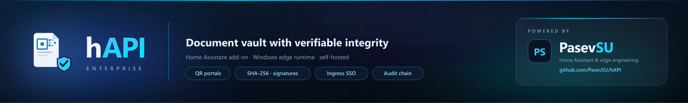

<p align="center"></p>

# 🏠 HOME ASSISTANT Portal Enterprise - hAPI Enterprise

[](https://www.apache.org/licenses/LICENSE-2.0)
[](https://github.com/PasevSU/hAPI)
[](https://hacs.xyz)

[](https://www.home-assistant.io/)
[](https://nodejs.org)
[](https://www.microsoft.com/windows)

[](BG.md)
[](DE.md)
[](README.md)

**hAPI Enterprise** (Home Assistant Portal Enterprise) ist eine Enterprise-Plattform für
Datei- und Portalverwaltung, die an der Grenze zwischen **Home Assistant** und **Windows**
läuft. Ein gemeinsames Node.js-Backend, eine Admin-Konsole, zwei Umgebungen — das
Home-Assistant-Add-on und eine eigenständige Windows-Desktop-Laufzeit. Nichts wird
entfernt: Jede Funktion liefert einen echten Backend-Handler und einen automatisierten Test.

Im Zentrum steht der **DOCFLOW-Kern**: Jedes Feld jedes Profils ist eine Variable mit dem
zusammengesetzten Schlüssel `{prefix}-{ID_db}-{id_gruppe}-{field}`, gebündelt unter einer
stabilen `id_gruppe`. Profile werden beim Anlegen eines Ordners automatisch erzeugt;
Datensätze können ohne Ordner existieren (orphan) und später zugeordnet werden. Die
Phasen 1–4 des Plans sind abgeschlossen.

✅ Home-Assistant-Add-on + HACS-Komponente
✅ Selbstextrahierendes Windows-Installationsprogramm mit eingebettetem Node.js
✅ Admin-Token vor dem Start des Home-Assistant-Add-ons konfigurierbar
✅ RBAC + Home-Assistant-Ingress-SSO
✅ Transaktionaler SQLite-Metadaten-Store
✅ Persistente Jobs, Gruppenoperationen, Backups, Diagnose
✅ Vollständiges Desktop-GUI mit 1:1-Backend-Abdeckung

---

## 💡 Die Idee

Ein Gericht, ein Notariat, eine Anwaltskanzlei oder jede Organisation, die mit offiziellen
Dokumenten arbeitet, braucht mehr als Speicherplatz: **Beweis**. Den Beweis, wer ein
Dokument eingereicht hat, wann, dass es seither nicht verändert wurde und dass die Kopie,
die man sieht, die echte ist.

hAPI Enterprise macht aus einer gewöhnlichen Home-Assistant-Installation (oder einem
Windows-PC) genau diese Maschine:

- **Strukturierter Kern** — jedes Dokument, jede Person und jede Akte lebt in einer
  konfigurierbaren *Variablen-Hierarchie* (DOCFLOW), nicht in einem flachen Ordner voller
  loser Dateien.
- **QR-Freigabe** — jede Akte oder jedes Dokument erhält einen **QR-Code**. Beim Scannen
  öffnet sich ein gebrandetes Portal, in dem der Empfänger das Dokument ansehen und —
  entscheidend — **verifizieren** kann.
- **Kryptografischer Beweis** — Uploads werden mit Hashes versehen, mit Signaturen und
  Zeitstempeln versiegelt und in einer manipulationssicheren Kette aufgezeichnet.

## 🔒 Das Problem — gefälschte Dokumente

Ein digitales Dokument lässt sich trivial fälschen. Ein PDF, ein Foto oder ein Scan kann
ohne sichtbare Spur bearbeitet werden. Im juristischen Kontext beweist „per E-Mail
erhalten“ oder „von einem Link heruntergeladen“ **nichts** über:

1. **Wer** es eingereicht hat und **wann** — Herkunft.
2. **Ob es sich verändert hat** — Integrität.
3. **Ob die Kopie auf dem Bildschirm identisch** mit dem Original ist — Verifikation.
4. **Ob die Beweiskette lückenlos** und prüfbar ist — Verwahrung.

E-Mail, USB-Sticks und Cloud-Links beantworten nichts davon. hAPI Enterprise beantwortet
alle vier mit **unabhängig nachprüfbarer Kryptografie**, nicht mit Versprechen.

## 📱 Wie der QR-Code die Echtheit eines Dokuments beweist

Wenn eine berechtigte Person (Staatsanwalt, Geschäftsstelle, Ermittler) ein offizielles
Dokument einreicht:

1. **Fingerabdruck.** SHA-256/SHA-512-Hashes werden *vor* dem Upload im Browser und
   *erneut* auf dem Server berechnet; sie müssen übereinstimmen.
2. **Beleg.** Ein kryptografischer Beleg wird ausgestellt — Hash, Größe, Einreicher und
   Zeit — versiegelt mit einer **PKCS#7-Signatur** und einem **RFC-3161-Zeitstempel**
   (für Beweismittel).
3. **Beweiskette.** Das Ereignis wird an ein **hash-verkettetes, append-only Audit-Log**
   angehängt: Jeder Eintrag trägt den Hash des vorherigen, sodass jede Änderung der
   Historie die Kette sichtbar bricht.
4. **QR-Code.** Ein QR-Code wird erzeugt. Beim Scannen öffnet sich das gebrandete Portal
   für die Akte/Datei.

Der Richter scannt den QR-Code, meldet sich an (Identitätsanbieter des Gerichts oder
PKCE + MFA) und sieht jedes Dokument mit seinem Integritätsstatus. Die Aktion
**„Verifizieren“** berechnet den Hash **im Browser** (WebCrypto) neu und vergleicht ihn mit
dem Beleg — grünes „Integrität bestätigt“ erscheint nur bei exakter Übereinstimmung. Ein
**Verifikationspaket** (Beleg + Signatur + Zeitstempel + Kette) kann heruntergeladen und
vom Gericht archiviert werden.

Da Beweismittel **unveränderlich (WORM)** sind und das Audit-Log hash-verkettet ist, kann
ein gefälschtes oder verändertes Dokument **die Verifikation nicht bestehen**, und jeder
Versuch wird dauerhaft aufgezeichnet. In hAPI Enterprise sind gefälschte Dokumente ein
**gelöstes Problem** — durch Mathematik erzwungen, nicht durch Vertrauen in einen Server.

## 🏆 Warum hAPI Enterprise

- **Self-Hosting am Edge.** Keine Cloud. Dokumente bleiben unter deiner Kontrolle — in
  Home Assistant oder auf einem Windows-PC.
- **Zero Trust.** RBAC, Home-Assistant-Ingress-SSO, AES-256-GCM-Verschlüsselung at rest,
  timing-sicherer Token-Vergleich.
- **Konfigurierbarer Kern statt Vorlage.** Die DOCFLOW-Hierarchie macht neue Profile zu
  *Daten*, nicht zu neuem Code.
- **Echte Funktionen, echte Tests.** Jede Funktion liefert einen Backend-Handler und
  einen automatisierten Test — nie nur eine UI-Schaltfläche.
- **Zwei Pakete, ein Backend.** Home-Assistant-Add-on (HACS) und eine eigenständige
  Windows-Laufzeit.
- **Mehrsprachig.** BG / DE / EN.

---

## 📦 Inhaltsverzeichnis

- [💡 Die Idee](#-die-idee)
- [🔒 Das Problem — gefälschte Dokumente](#-das-problem--gefälschte-dokumente)
- [📱 Wie der QR-Code die Echtheit beweist](#-wie-der-qr-code-die-echtheit-beweist)
- [🏆 Warum hAPI Enterprise](#-warum-hapi-enterprise)
- [✨ Funktionen](#-funktionen)
- [📦 Zwei einsatzbereite Pakete](#-zwei-einsatzbereite-pakete)
  - [💻 Windows-Paket (eingebettetes Node)](#-windows-paket-eingebettetes-node)
  - [🏠 Home-Assistant-Paket (HACS)](#-home-assistant-paket-hacs)
- [🚀 Windows - Schnellstart](#-windows---schnellstart)
- [🏠 Home Assistant - Schnellstart](#-home-assistant---schnellstart)
- [🗂️ Repository-Struktur](#️-repository-struktur)
- [🔐 Sicherheit](#-sicherheit)
- [📄 Lizenz & Beiträge](#-lizenz--beiträge)
- [🧭 Änderungsprotokoll](#-änderungsprotokoll)

---

## ✨ Funktionen

Jede unten aufgeführte Enterprise-Funktion ist als **echter Backend-Handler mit
automatisiertem Test** implementiert — niemals nur als UI-Schaltfläche:

| Modul                     | Funktion                                                                                  |
| ------------------------- | ----------------------------------------------------------------------------------------- |
| 🔧 Adaptive Laststeuerung  | Skaliert die Download-Parallelität anhand von Heap-Nutzung und Fehlerrate.                |
| 📦 Gruppenoperationen      | Änderung von Zugriffsmodus und Sichtbarkeit vieler Dateien mit Vorschau.                  |
| 🧰 Konfigurationsprofile   | Benannte, validierte, atomar gespeicherte Einstellungsprofile.                            |
| 💾 Backup & Restore        | Konsistente SQLite-Backups mit Integritätsprüfung beim Wiederherstellen.                  |
| 🔍 Speicherprüfungen       | Periodische Verfügbarkeits-/Schreibprüfungen pro Speicher.                                |
| 📒 Fehlerprotokoll         | Begrenztes JSONL-Protokoll mit Filterung nach Ebene und Quelle.                           |
| 🗃️ Job-Warteschlange       | FIFO, begrenzte Parallelität, Fortschritt, Abbruch, Pause/Fortsetzen, Wiederherstellung.  |
| 🔑 RBAC + SSO              | admin / operator / viewer-Token plus HA-Ingress-`X-Remote-User-Name`-Zuordnung.           |
| 📱 QR-Artefakte            | QR-Erzeugung für veröffentlichte Portale und Zugriffslinks.                               |
| 🩺 Diagnose                | RAM/Heap, Downloads, Anfragen, Fehler, Portale, Dateien, Speicher — ohne Geheimnisse.     |
| 🗄️ SQLite-Store            | Transaktionale Metadaten über `node:sqlite` `DatabaseSync`.                               |
| 🖥️ Desktop-GUI             | pywebview-GUI, das jede Admin-Funktion 1:1 abbildet.                                      |
| 🧬 DOCFLOW-Kern            | Gruppen/Profile/Datensätze/Variablen mit zusammengesetztem Schlüssel; orphan + Zuordnung. |
| 📄 Vorschau                | Office-/Dokument-Vorschau mit Limits und versioniertem Cache.                             |
| 🖼️ Thumbnails              | Dokument-Miniaturansichten (deaktivierbar über `preview.thumbnails`).                     |
| 🔢 Versionierung           | Dokumenthistorie mit Wiederherstellung.                                                   |
| 🌊 Wasserzeichen           | PDF-Wasserzeichen bei der Erzeugung.                                                      |
| 📊 PDF/OOXML               | PDF-Bilder (JPEG) + Tabellen; `xlsx`/`pptx`-Extraktion.                                   |
| 🔐 Verschlüsselung at rest | AES-256-GCM pro Datei (optional).                                                         |
| 🗓️ Retention + Audit       | Richtlinien für Dateien und Audit; Audit-Export (json/csv).                               |
| 🧾 QR-Landing              | Gebrandete Landing-Seite für QR-Einträge.                                                 |
| 🚫 QR-Widerruf             | Widerruf/Ablauf von QR-Links mit Rollback.                                                |
| 📨 Versand (notify)        | E-Mail/SMS über HA-Notify-Hooks (`notify.js`).                                            |

---

## 📦 Zwei einsatzbereite Pakete

> [!NOTE]
> Dasselbe Backend (`hapi_enterprise/server.js`) und dieselbe Admin-Konsole betreiben beide
> Pakete — die Grenze zwischen Home Assistant und Windows.

### 💻 Windows-Paket (eingebettetes Node)

Ein einzelnes **selbstextrahierendes Installationsprogramm**
(`hAPI_enterprise-v0.50.0-Windows-Setup.exe`) und ein **portables ZIP**
(`hAPI_enterprise-v0.50.0-Windows-Portable.zip`). Beide betten eine portable
**Node.js-22.16-Laufzeit** (kein System-Node erforderlich), das vollständige Backend, das
pywebview-Desktop-GUI, das SDK, die komplette Dokumentation und die Brand-Assets ein.

Die Windows-Edge-Laufzeit:

- erstellt ihr Datenverzeichnis unter `%LOCALAPPDATA%\hAPI_enterprise`,
- generiert und speichert beim ersten Start automatisch ein Admin-Token (`admin-token`),
- startet das vollständige Backend und bedient die Admin-Konsole unter
  `http://127.0.0.1:8098/admin` (nur Loopback).

### 🏠 Home-Assistant-Paket (HACS)

Ein vollständiges HACS-kompatibles Repository:

- das **Supervisor-Add-on** (`hapi_enterprise/`),
- die **HACS-Komponente** (`custom_components/hapi_enterprise/`) mit
  - Fail-closed-Bridge und Portalseite (`/api/hapi_enterprise/v1/…`,
    `/api/hapi_enterprise/portal/<id>`),
  - **UI-Einrichtung** (Config-/Options-Flow) — URL, Admin-Token, Intervall,
  - **7 Telemetrie-Sensoren** (Besuche, Downloads, Dateien, Portale, Dateispeicher,
    Datenbankgröße, Telemetriegröße),
  - `brand/icon.png` und `brand/logo.png` für die neue Home-Assistant-Oberfläche,
- `repository.yaml` und `hacs.json` für Installation mit einem Klick.

Schritte: [`documentation/08_USER_GUIDES/install-hacs.md`](documentation/08_USER_GUIDES/install-hacs.md).

Lege vor dem Start in der Add-on-**Konfiguration** ein eindeutiges Admin-Token mit
mindestens 24 Zeichen fest. Der Start wird verweigert, wenn das Token fehlt, zu kurz oder
ein Standardplatzhalter bzw. ein offensichtliches Wiederholungsmuster ist. Das Token wird
nicht im Add-on-Protokoll ausgegeben. Home Assistant Ingress verwendet dasselbe
HTTP/HTTPS-Schema wie die Home-Assistant-Oberfläche: TLS endet bei Home Assistant; das
Add-on verwendet HTTP nur am internen Port. Zertifikat- oder Schlüsselpfade sind in der
Add-on-Konfiguration nicht erforderlich.

---

## 🚀 Windows - Schnellstart

Das Windows-Paket ist eigenständig (eingebettetes Node).

> [!NOTE]
> Installer und portables ZIP werden als **separate Distribution** veröffentlicht und
> sind nicht Teil dieses Repositorys. Hier liegen der Quellcode, `START_HAPI_GUI.bat`
> (UI-Vorschau) und `node hapi_enterprise/standalone.js` (Backend + Admin-Konsole).

```bat
:: Lokale UI-Vorschau direkt von der Platte (Edge/Chrome im App-Modus)
START_HAPI_GUI.bat

:: Vollständiges Backend + Admin-Konsole auf http://127.0.0.1:8098/admin (nur Loopback)
node hapi_enterprise\standalone.js
```

Für die Arbeit direkt aus dem Repository genügen `START_HAPI_GUI.bat` (nur Oberfläche) oder
`node hapi_enterprise/standalone.js` (Backend + Admin-Konsole auf Loopback). Die
Desktop-GUI mit pywebview/WebView2 gehört zur separaten Windows-Distribution.

Das Admin-Panel im Browser ist eine separate Oberfläche von der vollständigen Desktop-GUI.

---

## 🏠 Home Assistant - Schnellstart

> [!CAUTION]
> Das Add-on benötigt **Node.js ≥ 22.13** (im Add-on-Image enthalten), damit `node:sqlite`
> `DatabaseSync` für den transaktionalen Store verfügbar ist.

1. In **HACS** dieses Repository als benutzerdefiniertes Repository (Typ **Integration**)
   hinzufügen und **hAPI Enterprise** installieren.
2. Unter **Supervisor → Add-on Store → ⋮ → Repositories** die Add-on-Repository-URL aus
   `repository.yaml` hinzufügen.
3. In der Add-on-**Konfiguration** ein eindeutiges Admin-Token mit mindestens 24 Zeichen
   festlegen und speichern; anschließend das Add-on **hAPI Enterprise** installieren/starten.
4. Die **Ingress**-Oberfläche öffnen und das konfigurierte Admin-Token in der Admin-Konsole eingeben.

Links zu veröffentlichten HTML-Projekten aus der Admin-Konsole verwenden die aktuelle
Ingress-Route und sind nur für authentifizierte Home-Assistant-Benutzer verfügbar.

> [!TIP]
> Die Komponente (`hapi_enterprise`) stellt eine Fail-Closed-Lesebrücke unter
> `/api/hapi_enterprise/v1/{tail}` bereit; sie leitet niemals administrative APIs weiter.

---

## 🗂️ Repository-Struktur

```
hapi_enterprise/            # HA-Add-on — gemeinsames Node.js-Backend (server.js + Module)
  server.js                 #   maßgebliches HTTP-Backend (HA + Windows)
  standalone.js             #   Windows-Edge-Bootstrap
  start.js / Dockerfile     #   HA-Add-on-Einstieg (reines JS, keine Shell) + Image
  config.yaml               #   Add-on-Metadaten / Optionen
  admin.html / admin.js     #   Web-Admin-Konsole
custom_components/hapi_enterprise/  # HACS-Komponente (Fail-Closed-Brücke)
tests/                      # Node-Integrationstests (node tests/*.cjs)
docs/                       # Plan, ADR und Dokumentation
img/                        # Banner, Logo und Brand-Bilder (README)
.dev/                       # Entwicklung in Arbeit (wird vor Release gemergt)
```

---

## 🔐 Sicherheit

Konten für die öffentliche API werden von einem Administrator angelegt. Benutzernamen,
gesalzene `scrypt`-Passwort-Hashes und Sitzungen werden in SQLite gespeichert. Clients
authentifizieren sich mit `POST /api/v1/auth/login` und senden das zurückgegebene
Bearer-Sitzungstoken. Das Deaktivieren eines Kontos macht seine Sitzungen ungültig. Das
Admin-Token ist davon getrennt.

Die vollständige Richtlinie steht unter [SECURITY.md](SECURITY.md): RBAC, Token-Bootstrap,
Ingress-SSO-Vertrauensgrenze, Loopback-Isolation, geheimnisfreie Diagnose und
timing-sicherer Token-Vergleich.

---

## 📄 Lizenz & Beiträge

Lizenziert unter der **Apache License, Version 2.0** — siehe [LICENSE](LICENSE).

Beiträge sind willkommen — siehe [CONTRIBUTING.md](CONTRIBUTING.md).

---

## 🧭 Änderungsprotokoll

- **v0.50.0** — Phase 4 abgeschlossen: Dokumentenverarbeitung (Vorschau, Thumbnails,
  Versionierung, Wasserzeichen, PDF-Bilder + Tabellen, xlsx/pptx), QR-Freigabe
  (gebrandete Landing, Widerruf/Ablauf, Versand via HA notify), ADR-011 und §9.1-
  Flexibilitätsmatrix.
- **v0.49.0** — DOCFLOW Phasen 1–3: Kern (Registry, Variable Store, Gruppen/Profile/
  Datensätze, orphan/Zuordnung), Flexibilität (DI, Event Bus, Repository) und
  HMAC-SHA256-Signatur.
- **v0.48.0** — Umbenennung `portal_enterprise` → **hAPI Enterprise** (`hapi_enterprise`).
- **v0.47.0** — Selbstextrahierendes Windows-Installationsprogramm mit eingebettetem Node;
  HACS-fähiges Repository mit `hacs.json` + Brand-Icons; das Add-on erfordert ein
  vorab konfiguriertes Admin-Token; mehrsprachige Dokumentation (BG / DE / EN) und
  Brand-`img/`-Assets.
- **v0.46.2** — `Dockerfile` des Add-ons korrigiert (alle Module werden kopiert);
  `build-platforms.cjs` hinzugefügt.
- **v0.46.1** — Repository-URLs auf `https://pasev.asuscomm.com/` gesetzt.
- **v0.46.0** — Desktop-GUI mit voller Backend-Abdeckung (1:1 zur Admin-API).
- **v0.45.0** — Edge/Standalone-Laufzeit (HA + Windows), Loopback-isolierter Admin-Listener.
- **v0.44.0** — Persistente Jobs, HA-Ingress-SSO, reproduzierbarer Build.
- **v0.44 RC8** — Enterprise-Module: Laststeuerung, Fehlerprotokoll, Konfigurationsprofile,
  Backup & Restore, Speicherprüfungen, RBAC.
- **v0.43 RC7** — Job-Manager (erste Ausbaustufe).

---

Erstellt von **PasevSU DEV** · Home Assistant Projects · Teil der freiwilligen Kampagne
**NO TRUST Cybersecurity**.
