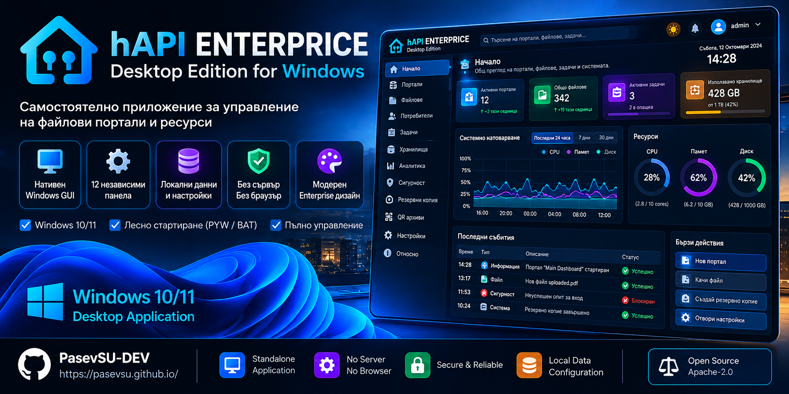

  

# hAPI Enterprise — Home Assistant add-on

**hAPI Enterprise** (Home Assistant Portal Enterprise) is a self-hosted platform for
**official document processing, QR sharing, and cryptographic evidence verification**.
It runs on the edge between **Home Assistant** and **Windows** — one shared Node.js
backend, one admin console, two environments.

It is *not* another file browser. It is a **document vault with mathematical proof**: the
moment an official document is submitted, its integrity becomes verifiable by a judge or
prosecutor in a court — without trusting the server that stores it.

---

## The idea

A court, a notary, a law office, or any organization dealing with official documents needs
one thing more than storage: **proof**. Proof of who submitted a document, when, that it
has not been altered since, and that the copy you are looking at is the real one.

hAPI Enterprise turns an ordinary Home Assistant installation (or a Windows PC) into that
machine:

- **Structured core** — every document, person, and case lives in a configurable
  *variable hierarchy* (DOCFLOW), not in a flat folder of loose files.
- **QR sharing** — each case or document gets a **QR code**. Scanning it opens a branded
  portal where the recipient can view and, crucially, **verify** the document.
- **Cryptographic proof** — uploads are fingerprinted, sealed with signatures and
  timestamps, and recorded in a tamper-evident audit chain.

## The problem it solves — forged documents

A digital document is trivial to forge. A PDF, a photo, or a scan can be edited with no
visible trace. In a legal context, "I received it by e-mail" or "I downloaded it from a
cloud link" proves **nothing** about:

1. **Who** submitted it and **when** — provenance.
2. **Whether it changed** after submission — integrity.
3. **Whether the copy on screen is identical** to the original — verification.
4. **Whether the chain of custody is unbroken** and auditable — custody.

E-mail, USB sticks, and cloud links answer none of these. hAPI Enterprise answers all four
with **cryptography that anyone can check independently**, not with promises.

## How the QR code proves a document is genuine

When an authorized person (prosecutor, clerk, investigator) submits an official document:

1. **Fingerprint.** SHA-256/SHA-512 hashes are computed *before* upload in the browser and
   *again* on the server; they must match.
2. **Receipt.** A cryptographic receipt is issued — hash, size, uploader, and time — sealed
   with a **PKCS#7 detached signature** and an **RFC 3161 timestamp** (for evidence).
3. **Chain of custody.** The event is appended to a **hash-chained, append-only audit log**:
   every record carries the hash of the previous one, so altering history visibly breaks
   the chain.
4. **QR code.** A QR is generated. Scanning it opens the branded portal for that case/file.

The judge scans the QR, signs in (court identity provider or PKCE + MFA), and sees every
document with its integrity status. A **Verify** action recomputes the hash **in the
browser** via WebCrypto and compares it against the receipt — a green "integrity confirmed"
appears only on an exact match. A **verification package** (receipt + signature + timestamp
+ chain) can be downloaded and archived by the court.

Because evidence is **immutable (WORM)** and the audit log is hash-chained, a forged or
modified document **cannot pass verification**, and every attempt is permanently recorded.
In hAPI Enterprise, forged documents are a **solved problem** — enforced by math, not by
trusting a server.

## Why hAPI Enterprise

- **Self-hosted on the edge.** No cloud. Documents stay under your control, in Home
  Assistant or on a Windows PC.
- **Zero Trust.** RBAC, Home Assistant Ingress SSO, AES-256-GCM encryption at rest,
  timing-safe token comparison.
- **Configurable core, not a template.** DOCFLOW's variable hierarchy means new profiles
  are *data*, not new code.
- **Real features, real tests.** Every feature ships a backend handler and an automated
  test — never just a UI button.
- **Two packages, one backend.** Home Assistant add-on (HACS) and a self-contained
  Windows runtime.
- **Multi-language.** BG / DE / EN.

---

## Overview

hAPI Enterprise is built around a **configurable core, not an enterprise template**. The
center is the *variable hierarchy*: every field of every profile is a variable with a
composite key `{prefix}-{ID_db}-{id_gruppe}-{field}`, grouped under a stable `id_gruppe`.
Profiles are generated automatically when a folder (group) is created; records can exist
without a folder (orphan) and be associated later.

| Layer | What it provides |
| ----- | ---------------- |
| **Core** | DI container, Event Bus, metadata-driven Registry, groups/profiles/records/variables |
| **Data** | Transactional SQLite store (`node:sqlite` `DatabaseSync`) behind a Repository interface |
| **Documents** | Preview, thumbnails, versioning, PDF watermarks, PDF images + tables, xlsx/pptx extraction |
| **Sharing** | QR artifacts, branded landing page, QR revocation, dispatch via Home Assistant notify |
| **Security** | RBAC + HA Ingress SSO, AES-256-GCM encryption at rest, retention + audit export |
| **Operations** | Backup/restore, job queue with progress, load control, storage checks, diagnostics, error log, config profiles |

Every feature ships with a real backend handler and an automated test — never just a UI
button. Architecture decisions are recorded as ADRs and every feature passes the §9.1
flexibility checklist (config-off, replaceable, interface, event, migration+rollback,
ADR, isolated test).

**Roadmap status:** Phases 1–4 are complete (core, flexibility, document processing, QR
sharing). Phases 5–7 are planned — settings + progress center, zero-damage migration, and
the **evidence portal** for judges and prosecutors
([plan](docs/plan/14-phase-7-evidence-portal.md)). The
[execution plan](docs/plan/09-execution-plan.md) and the
[master plan](docs/plan/08-master-plan-v5.0.md) are the canonical references.

## Repository layout

| Path                                  | Purpose                                                            |
| ------------------------------------- | ------------------------------------------------------------------ |
| `hapi_enterprise/`                  | The Home Assistant add-on (source, ready to build and run)         |
| `custom_components/hapi_enterprise/`| Optional HA custom integration (public API bridge)                 |
| `tests/`                              | Automated integration test suite (`node tests/*.cjs`)              |
| `docs/`                               | Documentation, ADRs and architecture plans                         |
| `img/`                                | Brand banners, logo and icons used by the documentation            |
| `.dev/`                               | In-progress development (merged into the add-on before a release)  |

## Requirements

- Node.js `>= 22.13` (required for the built-in `node:sqlite` `DatabaseSync` API)
- Home Assistant Supervisor for the add-on, or Windows for the desktop runtime

## Quick links

- [Documentation](docs/)
- [Architecture decisions (ADR)](docs/adr/)
- [Evidence portal plan (Phase 7)](docs/plan/14-phase-7-evidence-portal.md)
- [Security policy](SECURITY.md)
- [Contributing](CONTRIBUTING.md)
- [Release qualification](RELEASE_QUALIFICATION.md)

## License

[Apache 2.0](LICENSE)