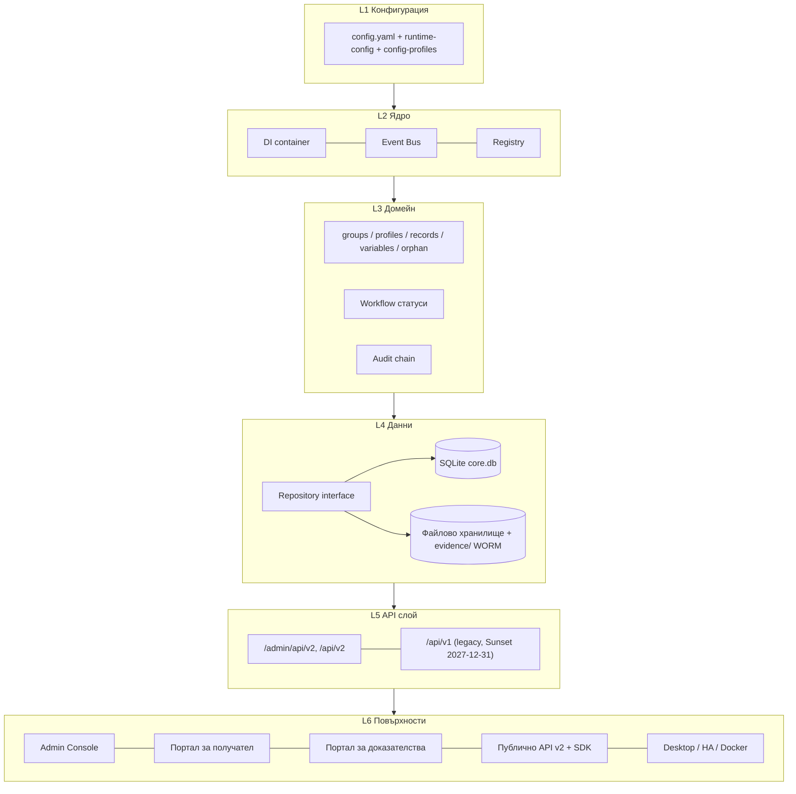

# hAPI Enterprise — Обединен проект v6.0 (единствен източник на истина)

> **Статус:** Каноничен. Този документ **обединява** всички идеи от:
> `docs/plan/00…14`, `documentation/` (00–08), текущия код (`hapi_enterprise/`,
> `custom_components/`, `tests/`), worktree `hAPI Enterptice.worktrees/pr/3-dependabot`
> и историческите проекти в `hapi_old/` (v0.43, v0.47 snapshot, HAPI.SU, doku/plan v1.0–v4.3).
> Оттук нататък **само този файл задава обхват и приоритет**. Останалите планове остават
> като история и детайлни приложения.
>
> **Дата:** 2026-10-20 · **Версия на плана:** 6.0 · **Продуктова версия:** 0.50.0
>
> **Актуален програмен план:** [`20-unified-plan-v7.md`](20-unified-plan-v7.md) — подрежда
> изпълнението на всички планове и съдържа архитектурата на двата канала (Ingress +
> Public API Gateway). Този документ остава източникът на продуктов обхват.

---

## 0. Как е направено обединяването

1. **Инвентар** на всеки източник (код, документ, архив) — §1.
2. **Правило за решения** — всяка идея получава едно от четири решения: `KEEP`, `MERGE`,
   `DROP`, `DEFER` — §2.
3. **Непроменливо ядро** — оригиналното изискване остава център — §3.
4. **Една архитектура, една продуктова повърхност** — §4, §5.
5. **Един roadmap** (фази 1–10) и **един backlog** с ID-та — §6, §7.
6. **Едно физическо репо** (целева структура + архивна политика) — §8.
7. **Трассируемост** идея → източник → решение → фаза — §9.

**Правило занапред:** нова идея се приема само ако влезе в §7 (backlog) с ID, фаза и
Definition of Done. Иначе остава бележка в §12 (идеи без решение).

---

## 1. Инвентар на източниците

### 1.1 Текущо репо — `hAPI Enterptice` (`final-package`, v0.50.0)

| Компонент | Състояние | Какво дава |
| --- | --- | --- |
| `hapi_enterprise/` (~40 модула) | Работещ | Единствен backend: DI, Event Bus, Registry, repository, SQLite, RBAC, crypto, QR, preview/PDF/OOXML, jobs, retention, backup, diagnostics |
| `tests/*.cjs` (**76** файла) | Работещи | Интеграционни тестове без зависимости |
| `custom_components/hapi_enterprise/` | Работещ | HA мост към порталното API (read-only, fail-closed, Range поддръжка) |
| `docs/plan/00…14` | Канонична история | Изискване → v1.0…v5.0 → фази 4–7 |
| `documentation/` (00–08) | Governance | Charter, WBS, ADR-0001…0023, миграция, тестове, release gate, ръководства |
| `scripts/run-tests.cjs`, `dev-dashboard.cjs` | Работещи | Test runner + dev dashboard |
| `RELEASE_QUALIFICATION.md` | Работещ | Release gate |

### 1.2 Worktree — `hAPI Enterptice.worktrees/pr/3-dependabot`

Съдържа само `.github/workflows` (Dependabot PR). **Решение:** `MERGE` — автоматичните
зависимости влизат в Фаза 10 (CI/доставка). Няма собствен продукт.

### 1.3 `hapi_old/hAPI_enterprice` (v0.43-rc7)

| Артефакт | Стойност | Решение |
| --- | --- | --- |
| `build.cjs`, `build-release.cjs`, `build-platforms.cjs` | Скриптове за 6 пакета (HA, Repo, Windows, Portable, Setup, Full) | `MERGE` → Фаза 9 |
| `hacs.json`, `repository.yaml`, `install.bat`, `START_WINDOWS.bat` | Дистрибуция | `MERGE` → Фаза 9 |
| `Brand_Kit/`, `img/` | Бранд | `MERGE` → Фаза 9 (един brand kit) |
| 8 PNG екрана (`01_Document_Register` … `08_Options_Menu`) | UI макети | `MERGE` → Фаза 5/7 (референция за UX) |
| `BG.md`, `DE.md`, `README.md`, `SECURITY.md` | Локализация | `KEEP` в текущото репо |

### 1.4 `hapi_old/hAPI_Enterptice_v0.47_snapshot`

| Артефакт | Стойност | Решение |
| --- | --- | --- |
| `sdk/client.mjs` | Първи публичен клиент на порталното API (`PortalClient`) | **`MERGE` → Фаза 8** (ядро на новия SDK) |
| `gui/` (`hapi-core.js` + 8 panel JS + `launch.html`) | Макет „8 Separate JS Panels“ | `DEFER` — референция за модуларизация на `admin.js` (Фаза 10) |
| `ui/` (PyWebView desktop: `Start_hAPI_ENTERPRICE.pyw`, `runtime.js`, `live.js`, `lang.js`) | Desktop обвивка | `MERGE` → Фаза 9 (Windows runtime) |
| `download_portal/` | По-стар backend (v0.47) | `DROP` (заменен от `hapi_enterprise/`) |
| `release/` | Стари пакети | `DROP` (архив) |

### 1.5 `hapi_old/HAPI.SU` (v0.49.1)

| Артефакт | Стойност | Решение |
| --- | --- | --- |
| `ANALYSIS.md` | **Критичен анализ v0.24 → v0.49.1** с 13 находки и 7 препоръки | **`MERGE` → Фаза 10** (всички препоръки стават задачи) |
| `sdk/client.mjs` | Същият клиент | `MERGE` → Фаза 8 |
| `custom_components/portal_enterprise/` | По-стар HA мост | `DROP` (заменен от `custom_components/hapi_enterprise/`) |
| `ui/`, `runtime/node.exe` (85 MB) | Desktop runtime | `MERGE` → Фаза 9 (runtime се сваля при билд, не се съхранява в git) |
| `download_portal/` | Стар backend | `DROP` |
| ~40 release архива (~660 MB) | История | `DROP` от git → `archive/RELEASES.md` (само списък + SHA-256) |

### 1.6 `hapi_old/doku/plan` (v1.0 → v4.3)

| Файл | Стойност | Решение |
| --- | --- | --- |
| `plan001_чернова.txt`, `plan001_v1.0.md` | Първоначална визия | `KEEP` като история |
| `v2.0.md` … `v4.3.md` | Еволюция (DOCFLOW → DDD → Multi-tenancy → Zero Trust) | `KEEP` като приложение; **`MERGE`** само приетите части (виж §9) |
| `v4.4.md` | **Празен файл** | `DROP` |

### 1.7 `hapi_old/portal_enterprise`

Съдържа само `.first-run-done` (маркер). **`DROP`** — не е проект.

### 1.8 ChatGPT — „Създаване на публично API“ (публичен share, прочетен 2026-10-20)

Разговорът (7–10.10.2026) покрива **четири отделни теми**, не само API:

| # | Тема от чата | Същност | Решение |
| --- | --- | --- | --- |
| 1 | **Публично API на портал** | „за всеки портал създава публично API“ + токен достъп | `MERGE` → **Фаза 8** (§6.9); в кода вече има `/api/v1/p/{slug}` |
| 2 | **Enterprise Dashboard GUI** | визуален дизайн за HA Portal Enterprise → преименуван hAPI ENTERPRICE, всички панели | `MERGE` → **Фаза 10** `UI-01` |
| 3 | **Standalone JS GUI (12 панела)** | HTML/CSS/JS без npm и backend, демо данни, `localStorage`, светла/тъмна тема, JSON експорт | `MERGE` → **Фаза 10** `UI-01` |
| 4 | **Enterprise Control Center (13 панела) + Report Studio** | ново модулно GUI; Report Studio с три области (библиотека, подредба, свойства); A4 preview; JSON манифест import/export; 8 вида елементи | **нова Фаза 11** (§6.12) |
| 5 | **Банеры** | 2 издания (Windows / Home Assistant) × 3 езика, 1280×640 GitHub Open Graph | `MERGE` → **Фаза 9** `PKG-04` |
| 6 | **Windows WebView2 runtime** | `Install_GUI_Dependency.bat` (pywebview), `Start_hAPI_ENTERPRICE.bat`, без браузър и без HA | `MERGE` → **Фаза 9** `PKG-05` |

**Най-важната нова идея — Report Studio (manifest-driven отчет):**

- Библиотека от **блокове и таблици**; подредба на документа чрез влачене.
- **Фиксирани граници:** `RFC 3161 START` → избрани процесни блокове и таблици →
  `RFC 3161 STOP`. Двете граници са заключени и не могат да се местят/трият.
- **Манифест** (JSON) описва ред, съдържание, стилове, видимост и настройки за печат;
  import/export от/към файл.
- **8 вида елементи** (заглавие, таблица, текст, изображение, QR, разделител, подпис, метаданни).
- A4 preview, PDF експорт, дигитален подпис (SHA-256), QR, PDF/A-3 като опции за експорт.

> **Извън обхват:** `HASH_REPORT_ENTERPRICE.7z` е **отделен проект** — не се внася, не се
> копира и не се ползва като референция. Report Studio се проектира само от изискванията
> на hAPI и от `pdf-writer.js`.

**Ограничение, което чатът сам налага (важно):** „Визуалният редактор няма да представя
демонстрационни времеви печати като действително издадени сертификати.“ Т.е. **никакъв
фалшив RFC 3161 токен** в preview — той се показва само след реален TSA отговор.

**Промяна на предишно решение:** Фаза 4 изключи „генератор на документи“ (ADR-0023).
Report Studio е точно такъв генератор, но **ограничен до отчети с криптографски обхват**.
Затова е нова фаза с нов ADR (ADR-0025), а не мълчаливо разширяване на Фаза 4.

---

## 2. Правило за решения (keep / merge / drop / defer)

| Решение | Значение | Критерий |
| --- | --- | --- |
| `KEEP` | Остава както е | Работи, тествано, в текущото репо |
| `MERGE` | Влиза в нова фаза | Има стойност, но не е реализирано или е в стар проект |
| `DROP` | Отпада | Дубликат, празно, или заменено от по-нов модул |
| `DEFER` | Отлага се | Има смисъл само при мащабиране (v7+) или зависи от друга фаза |

**Забрани (от историята на проекта):**
- Не се връщаме към `data JSONB`, microservices, PostgreSQL/Kafka/K8s/HSM като текуща
  архитектура (грешката на v4.0–v4.3, коригирана във v5.0).
- Не се добавя feature без backend handler + тест (правило от v0.49).
- Не се използва `ADMIN_TOKEN` за публични/портални повърхности.
- Не се съхраняват бинарни архиви и `node.exe` в git.

---

## 3. Непроменливо ядро (от `00-core-requirement.txt`)

```
Група (id_gruppe, 16 hex, стабилен, невидим)
   └── Профил (prefix 1000..5000, metadata-driven, автогенериран при създаване на папка)
         └── Поле (field)
               └── Стойност

Ключ: {prefix}-{ID_db}-{id_gruppe}-{field}
```

| prefix | Профил | Роля |
| --- | --- | --- |
| 1000 | Указател | Справочни записи |
| 1001 | Служител | Хора/контакти |
| 2000 | Картотека | Документи/досиета |
| 3000 | Портали | Портални връзки/QR |
| 4000 | Текстове | Стандартни текстове |
| 5000 | Шаблони | Шаблони за документи |

Правила, които не подлежат на обсъждане: `id_gruppe` (не `name_folder`) е в ключа;
orphan записите са първокласни; всички профили на една група споделят `id_gruppe`;
нов профил = **данни**, не код.

---

## 4. Единна архитектура



| Слой | Модули днес | Правило |
| --- | --- | --- |
| L1 | `config.yaml`, `runtime-config.js`, `config-profiles.js` | Всичко изключваемо/сменяемо |
| L2 | `container.js`, `event-bus.js`, `registry.js`, `plugins.js` | < 100 реда ядро, без домейн логика |
| L3 | `core-store.js`, `migration-bridge.js`, `signer.js`, `audit-chain.js`, `rbac.js`, `versioning.js` | Един контекст = един модул с интерфейс |
| L4 | `repository.js`, `sqlite-repository.js`, `sqlite-store.js`, `file-crypto.js`, `storage-*.js` | Никакъв SQL извън repository |
| L5 | `server.js` (рутер), `api-version.js`, `custom_components/` мост | Контракт преди код (OpenAPI) |
| L6 | `admin.html/js`, `portal.html/js/css`, `preview.js`, `pdf-writer.js`, `ooxml.js`, `qrcode.js` | Без бизнес логика в UI |

**Известен дълг:** `server.js` и `admin.js` са монолитни (находка №8 от `ANALYSIS.md`) —
адресира се във Фаза 10, не се пренаписва изведнъж.

---

## 5. Една продуктова повърхност (6 плоскости)

| # | Плоскост | За кого | Състояние |
| --- | --- | --- | --- |
| 1 | **Admin Console** (йерархия Група → Профил → Поле) | администратор, деловодител | ✅ |
| 2 | **Портал за получател** (QR landing, файлове, ключ) | външен получател | ✅ |
| 3 | **Портал за доказателства** (роли, верификация, верига на пазене) | съд, прокуратура, вещи лица | 🟡 Фаза 7 |
| 4 | **Публично API + SDK** | интегратори, външни системи | 🟡 Фаза 8 |
| 5 | **Report Studio** (манифест → отчет с RFC 3161 обхват) | деловодител, вещо лице, съд | 🟡 Фаза 11 |
| 6 | **Runtime** (HA add-on, Windows WebView2 desktop/portable, Docker/edge) | инсталатор | ✅ код / 🟡 Фаза 9 пакетиране |

Всяка плоскост има **собствена автентикация** и **собствен одит**; нито една не ползва
администраторския токен.

---

## 6. Единен roadmap v6.0

> **Ред на изпълнение (2026-10-20):** центърът е порталът, файловете и управлението —
> виж [`17-portal-files-management-plan.md`](17-portal-files-management-plan.md). Report Studio
> (Фаза 11) е **след** тях: работи като прототип, но не е приоритет и не се брои за готов
> продукт, докато не чете реални данни (`F8-4`).

| Фаза | Име | Статус | Ключов резултат |
| --- | --- | --- | --- |
| 0 | **Консолидация** (този документ, архив, един индекс) | 🟡 сега | Един източник на истина, чисто репо |
| 1 | Ядро (променлива йерархия) | ✅ | Registry, variable store, групи/профили/записи, orphan |
| 2 | Гъвкавост | ✅ | DI, Event Bus, Repository, плъгини, версиониран API |
| 3 | Цялост (подпис) | ✅ | HMAC-SHA256 receipt |
| 4 | Документи + QR | ✅ | Preview, thumbnails, версии, водни знаци, PDF/OOXML, QR landing + отмяна |
| 5 | Настройки + център за прогрес | 🟡 план 12 | 7 секции настройки, постоянен прогрес, Event Bus |
| 6 | Миграция без щети | 🟡 план 13 | Copy→Verify→Switch, dry-run, rollback, resume |
| 7 | Портал за доказателства | 🟡 план 14 | Роли, PKCE/OIDC, SHA-256/512, PKCS#7, RFC 3161, верига, WORM |
| 8 | **Публично API v2 + SDK** | 🆕 | Контракт-първо API, scoped токени, SDK, webhooks |
| 9 | **Пакетиране и доставка** | 🆕 | 6 пакета от един build, Windows WebView2 runtime, 6 банера |
| 10 | **Качество и CI** | 🆕 | HA интеграция, Playwright UI, Enterprise Control Center (13 панела), модуларизация |
| 11 | **Report Studio** (manifest-driven отчети + RFC 3161 обхват) | 🆕 | JSON манифест, 8 елемента, START→STOP, A4/PDF, без фалшиви токени |

### 6.1 Фаза 0 — Консолидация (тази седмица)

1. Този документ е каноничен; `docs/README.md` и governance индексите сочат към него.
2. `archive/` в репото: `MANIFEST.md` (източник, дата, SHA-256), `RELEASES.md` (списък на
   старите пакети), `PLANS/` (v1.0–v4.3, `ANALYSIS.md`), `SDK/` (`client.mjs` v0.47).
3. `hapi_old/` остава **извън** git; бинарните архиви (660 MB) не се качват.
4. Worktree `pr/3-dependabot` се влива през нормален PR; нови worktree-та се именуват
   `<phase>-<topic>`.
5. ADR-0024 записва решението за обединяване.

**DoD:** няма два документа, които да дават различен roadmap; всеки стар артефакт има
ред в `archive/MANIFEST.md` с решение `KEEP/MERGE/DROP/DEFER`.

### 6.2–6.6 Фази 1–5

Фази 1–4 са завършени — виж `09-execution-plan.md` и `10-phase-4-gap-closure.md`.
Фаза 5 остава по `12-phase-5-settings-and-progress.md`, с едно допълнение от §7:
`BUG-05` (заключване по IP зад Ingress) и `BUG-06` (slug → API директория).

### 6.7 Фаза 6 — Миграция

По `13-phase-6-migration-architecture.md` без промени. Задължително: `dry-run` по
подразбиране, `sourcePreserved: true`, checkpoint на всеки батч.

### 6.8 Фаза 7 — Портал за доказателства

По `14-phase-7-evidence-portal.md` без промени. Зависимости: Фаза 5 (прогрес),
Фаза 6 (внасяне на съществуващи доказателства), Фаза 8 (верификационните endpoint-и
излизат и в публичното API).

### 6.9 Фаза 8 — Публично API v2 + SDK (нова, от темата „Създаване на публично API“)

**Цел:** порталното API да е **продукт с договор**, а не страничен ефект от UI-то.

**Принципи**
1. **Контракт-първо:** `api/openapi.yaml` е източникът; `openapi.json` на портал се
   генерира; CI сравнява спецификация ↔ реални маршрути.
2. **Една повърхност, много клiенти:** браузър, HA мост, SDK, външни системи.
3. **Никакви тайни в URL;** ключовете пътуват в заглавки, подписаните URL са краткотрайни.
4. **Всичко се одитира:** `access.api.*` във веригата.

**Автентикация — 4 класа идентичности**

| Клас | Носител | Обхват | Живот |
| --- | --- | --- | --- |
| Порталeн ключ | `X-Portal-Key` | `portal:read` | до ротация |
| Файлов ключ | `X-File-Key` | един файл | до изтичане/отмяна |
| Service токен | `Authorization: Bearer` | `portal:read`, `file:read`, `file:write`, `verify:read`, `chain:read`, `qr:admin` | 15 мин + refresh |
| Крайни потребители (съд) | PKCE/OIDC сесия | роли от Фаза 7 | 15 мин |

**Ресурси (v2)**

| Метод | Път | Обхват |
| --- | --- | --- |
| `GET` | `/api/v2/portals` | `portal:read` (списък на достъпните) |
| `GET` | `/api/v2/p/{slug}` | `portal:read` |
| `GET` | `/api/v2/p/{slug}/manifest` | `portal:read` |
| `GET` | `/api/v2/p/{slug}/files` | `portal:read` (филтри, cursor) |
| `GET` | `/api/v2/p/{slug}/files/{id}` | `file:read` |
| `POST` | `/api/v2/p/{slug}/files` | `file:write` (+ `Idempotency-Key`) |
| `GET` | `/api/v2/p/{slug}/files/{id}/download` | `file:read` (Range, ETag) |
| `GET` | `/api/v2/p/{slug}/files/{id}/verify` | `verify:read` |
| `GET` | `/api/v2/p/{slug}/files/{id}/chain` | `chain:read` |
| `POST` | `/api/v2/p/{slug}/tokens` | `qr:admin` (издаване/ротация) |
| `POST` | `/api/v2/hooks` | `qr:admin` (webhook регистрация) |

**Договорни изисквания**
- **Грешки:** RFC 9457 `application/problem+json` — `type`, `title`, `status`, `detail`, `instance`, `requestId`.
- **Пагинация:** `limit`/`cursor` (offset остава за v1 legacy).
- **Кеш:** `ETag` + `If-None-Match` → `304`; `Cache-Control: no-store` за доказателства.
- **Повторяемост:** `Idempotency-Key` за `POST /files` (24 h прозорец).
- **Ограничения:** `429` + `Retry-After`; лимит по токен, не по IP (поправя `BUG-05`).
- **Версиониране:** `/api/v2` текущ; `/api/v1` legacy с `Deprecation: true` и
  `Sunset: 2027-12-31` (вече в `api-version.js`).
- **Събития:** webhooks `file.uploaded`, `file.verified`, `chain.broken`, `qr.revoked`
  с HMAC-подпис и повторни опити (backoff).

**SDK**
- `sdk/js/` — `PortalClient` (от `hapi_old/**/sdk/client.mjs`), разширен с upload,
  verify, chain, токени и webhook helper; `package.json` за npm, ESM + CJS.
- `sdk/python/` — тънък клиент (`urllib` + `hashlib`, без зависимости) — `DEFER` до
  поискване.
- Примери: `sdk/examples/{read,upload,verify}.mjs`; Postman колекция в `api/`.

**DoD:** OpenAPI 3.1 валиден; CI проверява маршрути; SDK покрива 100 % от v2;
тестове `tests/api-v2-*.cjs` (auth, scopes, idempotency, range, 429, problem+json,
webhook подпис); `docs/api/` с quickstart за 3 сценария.

**Статус (2026-10-20):** ядрото на Фаза 8 е готово —

- `hapi_enterprise/api-spec.js` — чисти функции: `buildReferences`, `buildApiRecord`,
  `buildOpenApi` (OpenAPI 3.1, `X-Portal-Key`/`X-File-Key`), UMD за Node и браузър;
- `hapi_enterprise/api-registry.js` — създава/чете/трие хранилище `api/<slug>/`
  (`api.json`, `openapi.json`, `qr.svg`), атомарни записи;
- API: `POST|GET|DELETE /admin/api/v2/portals/{slug}/api` (генериране, четене,
  изтриване на хранилището, с препратки в отговора);
- публичният `GET /api/v1/p/{slug}/openapi.json` сервира **генерирания** договор,
  а при липса — legacy `spec()`;
- **виртуално хранилище** (`hapi_enterprise/virtual-storage.js`, UMD): йерархия
  `topic → category → group → файл`; `GET …/manifest` дава `path` за всеки файл,
  `GET …/storage[?path=]` връща дървото; `api.json` съдържа
  `storage { virtual, scheme, folderCount, fileCount }`; OpenAPI описва `/storage`;
- GUI: панел „Портали & API“ генерира същите файлове в браузъра (демо), показва
  виртуалното дърво и ги сваля.

Остават: service токени с обхвати (`API-02`), `problem+json`/`ETag`/`Idempotency-Key`
(`API-04`), SDK пакет (`API-05`), webhooks (`API-06`).

### 6.10 Фаза 9 — Пакетиране и доставка

`MERGE` от `hapi_old`: `build.cjs`, `build-release.cjs`, `build-platforms.cjs`,
`install.bat`, `START_WINDOWS.bat`, `hacs.json`, `repository.yaml`, `Brand_Kit/`.

Шест пакета от един build: **HA add-on**, **Repo (HACS)**, **Windows (код)**,
**Windows Portable**, **Windows Setup**, **Full (с тестове)**.

- **Windows runtime (WebView2):** desktop обвивка с `Install_GUI_Dependency.bat`
  (`pywebview`) + `Start_hAPI_ENTERPRICE.bat`, без браузър и без HA (от чата §1.8).
- **Банеры:** 2 издания (Windows / Home Assistant) × 3 езика (BG/DE/EN), 1280×640
  GitHub Open Graph; поставят се в Repository → Settings → Social preview.
- Изисквания: една версия навсякъде (`config.yaml`, `manifest.json`, `package.json`);
  Windows runtime (`node.exe`) се сваля при билд, не се пази в git; SHA-256 манифест на
  всеки артефакт; ръководства BG/DE/EN.

### 6.11 Фаза 10 — Качество и CI (всички препоръки от `ANALYSIS.md`)

| ID | Задача | Източник |
| --- | --- | --- |
| `BUG-01` | Интеграционен тест срещу работещ HA в CI | ANALYSIS №1 |
| `BUG-02` | Playwright UI тест за основните потоци | ANALYSIS №2 |
| `BUG-03` | По-добро конвертиране docx→PDF (картинки/таблици) | ANALYSIS №3 |
| `BUG-04` | `{{променлива}}` в имена/описания на портали, пътища, имейли | ANALYSIS №4 |
| `BUG-05` | Ограничаване на грешните опити по токен, не по IP | ANALYSIS №5 |
| `BUG-06` | Преместване на API директорията при смяна на slug | ANALYSIS №6 |
| `BUG-07` | Отваряне в програма — само Windows, документиран лимит | ANALYSIS №7 |
| `BUG-08` | Модуларизация на `server.js` / `admin.js` | ANALYSIS №8 |
| `BUG-09` | Довършване на дизайна по макетите (8 екрана) | ANALYSIS №9 |
| `BUG-10` | Почистване на стари архиви (последни 2–3 версии) | ANALYSIS №10 |
| `BUG-11` | Проверка на немските низове в новите панели | ANALYSIS №13 |
| `UI-01` | **Enterprise Control Center** — 13 панела (Dashboard, Портали, Файлов мениджър, Потребители/RBAC, Задачи, Хранилища, Анализи, Сигурност, Резервни копия, QR архиви, Report Studio, Настройки, Относно) | чат §1.8 т. 2–4 |
| `UI-02` | Модулен JS фронтенд (един панел = един модул), без npm; `localStorage` само за dev; JSON експорт | чат §1.8 т. 3 |

**Правило от чата:** демо прототипът може да ползва симулирани данни, но **не** може да
показва фалшиви RFC 3161 токени, фалшиви подписи или „удостоверен PDF“.

**Статус (2026-10-20):** обвивката е готова — `ui/` с 13 панела, BG/DE/EN, тъмна/светла
тема и ДЕМО данни. `UI-01` остава 🟡 до свързването с backend; `UI-02` 🟡.

### 6.12 Фаза 11 — Report Studio (manifest-driven отчети)

> **Статус:** `RS-01` ✅ 2026-10-20 — `hapi_enterprise/report-manifest.js`
> (`normalize` / `validate` / `check` / `assertValid` / `digest` / `canonical` /
> `template` / `schema`) + `tests/report-manifest.cjs` (15 групи проверки).
> `RS-02` ✅ 2026-10-20 — `ui/report-studio.js`: библиотека (9 типа), подредба с
> заключени START/STOP, свойства, A4 preview, import/export на JSON, SHA-256 хеш.
> `RS-03` ✅ 2026-10-20 — `hapi_enterprise/report-render.js` (манифест → PDF чрез
> `pdf-writer.js`, A4/portrait, многостраничност) + `POST /admin/api/v2/reports/render`
> + `tests/report-render.cjs`, `tests/report-api.cjs`.
> `RS-04` ✅ — всички 9 елемента + `hash-table`; изображение само JPEG (лимит на
> `pdf-writer`), QR е текст до `RS-06`.
> `RS-05…RS-07` 🟡.

**Цел:** деловодител/вещо лице да сглобява отчет от блокове, а системата да го
изпълнява **в криптографски обхват** — от `RFC 3161 START` до `RFC 3161 STOP`.

**Модел на манифеста** (`report-manifest.json`)

```json
{
  "schemaVersion": 1,
  "profile": "forensic-full",
  "page": { "format": "A4", "orientation": "portrait", "marginsMm": [15, 15, 15, 15] },
  "branding": { "organization": "{{organization}}", "logo": "brand/logo.png", "qr": true },
  "blocks": [
    { "id": "start", "type": "rfc3161-start", "locked": true, "label": "RFC 3161 START" },
    { "id": "b1", "type": "table", "source": "records:1000", "columns": ["name", "adresse", "telefon"] },
    { "id": "b2", "type": "hash-table", "algorithms": ["CRC32", "MD5", "SHA1", "SHA256", "SHA512"] },
    { "id": "stop", "type": "rfc3161-stop", "locked": true, "label": "RFC 3161 STOP" }
  ],
  "print": { "pageNumbers": true, "headerFooter": true, "footerNote": "NO TRUST — VERIFY EVERYTHING" }
}
```

**Правила**
1. `rfc3161-start` и `rfc3161-stop` са **задължителни, заключени и първи/последни**.
   Манифест без тях се отхвърля с `400`.
2. Изпълнението е **последователно**: START → блокове по ред → STOP. Никакъв паралелизъм
   на TSA заявките в един отчет.
3. **Preview ≠ сертификат:** докато няма реален TSA отговор, полетата `tsaToken` и
   `signature` стоят празни с бележка „не е издаден“.
4. **Един манифест = един отчет.** Версиите на манифеста се пазят (immutable), за да е
   възпроизводим всеки издаден отчет.
5. **8 вида елементи:** заглавие, текст, таблица, изображение, QR, разделител, подпис,
   метаданни (плюс `hash-table` и `rfc3161-*` като системни).
6. Експорт: **PDF**, **PDF/A-3** (опция), дигитален подпис **SHA-256**, QR.
7. Всичко се одитира: `report.manifest.saved`, `report.generated`, `report.tsa.ok|fail`.

**Зависимости:** Фаза 7 (`signer.js` → PKCS#7 + RFC 3161 TSA), Фаза 5 (настройки/прогрес),
`pdf-writer.js` (разширяване с A4 layout), `qrcode.js`, `ooxml.js`.

**DoD:** манифест със схема + валидатор; редактор (библиотека/подредба/свойства/A4 preview);
import/export JSON; рендер START→STOP; тестове `tests/report-manifest.cjs`,
`tests/report-render.cjs`, `tests/report-tsa-scope.cjs` (без TSA → няма token; с TSA →
token само между START и STOP); PDF отчет с хеш таблица; нито един фалшив токен в preview.

---

## 7. Обединен backlog (един списък, с ID)

Приоритет: `P0` = блокер за release, `P1` = следваща фаза, `P2` = подобрение, `P3` = отложено.

| ID | Задача | Фаза | Приоритет |
| --- | --- | --- | --- |
| `CON-01` | Този документ + индексите | 0 | P0 |
| `CON-02` | `archive/MANIFEST.md`, `RELEASES.md`, `PLANS/`, `SDK/` | 0 | P0 |
| `CON-03` | Вливане на `pr/3-dependabot` | 0 | P1 |
| `CON-04` | ADR-0024 (обединяване) | 0 | P1 |
| `S5-01` | Екран „Настройки“ (7 секции) | 5 | P1 |
| `S5-02` | Център за прогрес/статус (Event Bus) | 5 | P1 |
| `MIG-01` | Тръбопровод PRECHECK→REPORT | 6 | P1 |
| `MIG-02` | `migrate` API + rollback | 6 | P1 |
| `E7-01` | Публичен екран + manifest без съдържание | 7 | P1 |
| `E7-02` | Роли съд + PKCE/OIDC | 7 | P1 |
| `E7-03` | Клиентска верификация (WebCrypto SHA-256/512) | 7 | P1 |
| `E7-04` | EVIDENCE качване (WORM, receipt) | 7 | P1 |
| `E7-05` | PKCS#7 detached + RFC 3161 TSA | 7 | P2 |
| `E7-06` | PDF отчет по делото | 7 | P2 |
| `API-01` | `api/openapi.yaml` + CI проверка | 8 | P1 |
| `API-02` | Service токени + обхвати | 8 | P1 |
| `API-03` | v2 маршрути (files, download, verify, chain) | 8 | P1 |
| `API-04` | `problem+json`, `ETag`, `Idempotency-Key`, `429` | 8 | P1 |
| `API-05` | `sdk/js` + примери + Postman | 8 | P1 |
| `API-06` | Webhooks с HMAC подпис | 8 | P2 |
| `PKG-01` | Един build → 6 пакета | 9 | P1 |
| `PKG-02` | Една версия навсякъде | 9 | P1 |
| `PKG-03` | Windows runtime + desktop обвивка (`ui/`) | 9 | P2 |
| `PKG-04` | Brand kit + 6 банера (2 издания × 3 езика) + ръководства BG/DE/EN | 9 | P2 |
| `PKG-05` | Windows WebView2 обвивка (`Install_GUI_Dependency.bat`, `Start_hAPI_ENTERPRICE.bat`) | 9 | P2 |
| `BUG-01`…`BUG-11` | Виж §6.11 | 10 | P1/P2 |
| `UI-01` | Enterprise Control Center — 13 панела | 10 | P1 |
| `UI-02` | Модулен JS фронтенд (един панел = един модул) | 10 | P2 |
| `RS-01` | Схема + валидатор на `report-manifest.json` (START/STOP задължителни) | 11 | P1 |
| `RS-02` | Редактор: библиотека / подредба / свойства / A4 preview | 11 | P1 |
| `RS-03` | Рендер START → блокове → STOP (`pdf-writer` A4 layout) | 11 | P1 |
| `RS-04` | 8 вида елементи + `hash-table` (CRC32/MD5/SHA1/SHA256/SHA512) | 11 | P2 |
| `RS-05` | Връзка с TSA: токен само между START и STOP; без фалшиви токени | 11 | P1 |
| `RS-06` | Експорт PDF / PDF-A3 / SHA-256 подпис / QR | 11 | P2 |
| `RS-07` | Версиониране на манифеста (възпроизводимост на издаден отчет) | 11 | P2 |

---

## 8. Едно физическо репо

### 8.1 Целева структура

```
/
├── hapi_enterprise/            # Единственият backend (add-on source)
├── custom_components/
│   └── hapi_enterprise/        # HA мост към публичното API
├── START_HAPI_GUI.bat          # Стартира GUI-я от диска (Edge/Chrome app, без сървър)
├── api/                        # NEW: postman.json, публикуван OpenAPI договор
├── sdk/
│   └── js/                     # NEW: client.mjs, package.json, examples/
├── ui/                         # Enterprise Control Center (чист JS, без сървър и npm)
│   ├── index.html              # 20-редова обвивка (script тагове + nav/main)
│   ├── styles.css
│   ├── data.js                 # ДЕМО данни + примерен манифест (без fetch)
│   ├── app.js                  # 13 панела, BG/DE/EN, навигация
│   ├── portals.js              # Портали & API: генериране, хранилище, препратки
│   ├── report-studio.js        # библиотека → подредба → свойства → A4 preview
│   └── manifest.example.json   # валиден примерен манифест (за тестове)
├── archive/                    # NEW: read-only история
│   ├── MANIFEST.md
│   ├── RELEASES.md
│   ├── PLANS/                  # v1.0–v4.3, ANALYSIS.md
│   └── SDK/                    # client.mjs (v0.47, референция)
├── docs/
│   ├── README.md               # индекс
│   ├── plan/                   # 00…15 (15 = каноничен)
│   └── api/                    # NEW: quickstart, auth, errors, webhooks
├── documentation/              # governance, ADR, миграция, тестове, release
├── tests/                      # 76 файла → + api-v2-*, portal-*
├── scripts/                    # run-tests, dev-dashboard, build
├── img/
└── package.json
```

### 8.2 Архивна политика

- `archive/` е **само за четене** — без промени по код.
- Бинарни архиви (`.zip`, `.7z`, `.exe`, `node.exe`) **не влизат в git**; остава
  запис в `archive/RELEASES.md` (име, версия, размер, SHA-256).
- `hapi_old/` остава на диска като студен архив; нищо не се трие без твоето изрично
  потвърждение.

---

## 9. Трассируемост: идея → източник → решение → фаза

| Идея | Източник | Решение | Фаза |
| --- | --- | --- | --- |
| Променлива йерархия, композитен ключ | `00-core-requirement.txt` | KEEP | 1 ✅ |
| Metadata-driven Registry | v3.0 §2.3 | MERGE | 2 ✅ |
| Orphan записи + асоцииране | `00-core-requirement.txt` | KEEP | 1 ✅ |
| DI + Event Bus + Repository | v3.0 / v5.0 §2.2 | MERGE | 2 ✅ |
| Verсиониран API + legacy bridge | v5.0 §6.2 | MERGE | 2 ✅ |
| HMAC-SHA256 receipt | v5.0 §6.3 | MERGE | 3 ✅ |
| Preview, thumbnails, версии, водни знаци | `10-phase-4` | MERGE | 4 ✅ |
| QR landing + отмяна + notify | `10-phase-4` §4.4 | MERGE | 4 ✅ |
| Настройки UI + прогрес | `12-phase-5` | MERGE | 5 |
| Zero-damage миграция | `13-phase-6` | MERGE | 6 |
| Портал за доказателства, роли | `14-phase-7` | MERGE | 7 |
| PKCS#7 + RFC 3161 | `14-phase-7` §6.1 | MERGE | 7 |
| Публично API като продукт | ChatGPT тема + `sdk/client.mjs` + `spec()` | MERGE | 8 |
| SDK клиент | `hAPI_Enterptice_v0.47_snapshot/sdk/client.mjs` | MERGE | 8 |
| HA мост | `custom_components/hapi_enterprise/` | KEEP | ✅ |
| 6 пакета от един build | `hapi_old/hAPI_enterprice/build-*.cjs` | MERGE | 9 |
| Desktop runtime (PyWebView) | `hapi_old/**/ui/` | MERGE | 9 |
| Brand kit | `hapi_old/**/Brand_Kit`, `img/` | MERGE | 9 |
| 6 банера (Windows/HA × BG/DE/EN, 1280×640) | чат §1.8 т. 5 | MERGE | 9 |
| Windows WebView2 обвивка | чат §1.8 т. 6 | MERGE | 9 |
| 8 UI макета | `hapi_old/hAPI_enterprice/*.png` | MERGE (референция) | 10 |
| `gui/hapi-core.js` (8 панела) | `v0.47_snapshot/gui/` | MERGE (референция) | 10 |
| Критики 1–13 | `HAPI.SU/ANALYSIS.md` | MERGE | 10 |
| Enterprise Dashboard (визуален дизайн) | чат §1.8 т. 2 | MERGE | 10 |
| Standalone JS GUI (12 панела) | чат §1.8 т. 3 | MERGE | 10 |
| Enterprise Control Center (13 панела) | чат §1.8 т. 4 | MERGE | 10 |
| Report Studio (манифест, START/STOP, A4, 8 елемента) | чат §1.8 т. 4 | MERGE | **11** |
| „Без фалшиви RFC 3161 токени“ | чат §1.8 | KEEP (правило) | 11 |
| DDD bounded contexts | v4.1 | MERGE (като модули) | — |
| Multi-tenancy реална | v4.2 | DEFER | v7+ |
| Zero Trust пълен (OIDC/MFA/OPA/HSM) | v4.3 | DEFER (OIDC/MFA → 7) | 7/v7+ |
| PostgreSQL/Kafka/K8s/polyglot | v4.0–v4.3 | DROP | — |
| `data JSONB` | v4.0 | DROP | — |
| Стари backend-и (`download_portal/`) | v0.43/v0.47/HAPI.SU | DROP | — |
| `portal_enterprise/` (само маркер) | `hapi_old` | DROP | — |
| `v4.4.md` (празен) | `doku/plan` | DROP | — |
| `node.exe` в git | `HAPI.SU/runtime` | DROP | — |
| ~660 MB releases в git | `HAPI.SU/release/` | DROP | — |

---

## 10. Управление

- **ADR:** всяко архитектурно решение → `documentation/03_ADR/` (следващи: ADR-0026+).
- **DoD:** `documentation/00_GOVERNANCE/DEFINITION_OF_DONE.md` + §9.1 checklist
  (изключва се, сменя се, интерфейс, събитие, миграция+rollback, ADR, изолиран тест).
- **Change control:** `CHANGE_CONTROL.md`; промяна на този план = нова версия (6.1, 6.2…).
- **Release gate:** `RELEASE_QUALIFICATION.md` + `documentation/07_RELEASE/`.
- **Тестове:** `npm test` (`scripts/run-tests.cjs`), 76 файла, без външни зависимости.

---

## 11. Дефиниция за „един проект“ (acceptance за Фаза 0)

- [x] Този файл е посочен канонично от `docs/README.md`,
      `documentation/00_GOVERNANCE/MASTER_PROJECT_PLAN.md`, `ROADMAP.md` и `README.md`.
- [x] `archive/MANIFEST.md` съдържа всеки артефакт от `hapi_old/` с решение.
- [x] `archive/PLANS/README.md` картографира `doku/plan/v1.0–v4.3` към `docs/plan/` (без копия).
- [x] ADR-0024 (обединяване) и ADR-0025 (Report Studio) са приети и индексирани.
- [x] Нито един roadmap не противоречи на §6.
- [x] Всеки стар план (v1.0–v4.3) е `MERGE`-нат в §9, `KEEP` като история, `DEFER` или `DROP`.

**Фаза 0 е завършена (2026-10-20).** Остава само консолидацията на worktree
(`CON-03`) — при следващ PR.

---

## 12. Идеи без окончателно решение (чакат вход)

1. **Python SDK** — отложен до реално поискване.
2. **Multi-tenancy / SaaS** — отложен до излизане от Home Assistant (v7+).
3. **Генератор на документи (профил 5000)** — изключен във Фаза 4 (ADR-0023); **частично
   отменен** с ADR-0025 само за отчети: Report Studio (Фаза 11) генерира отчети по
   манифест с RFC 3161 обхват. Свободни шаблони за писма/договори остават извън обхват.
4. **Квалифицирани подписи извън EVIDENCE** — извън обхват, освен ако не стане
   изискване за правна сила на всички документи.
5. **`HASH_REPORT_ENTERPRICE.7z`** — **отделен проект**, не е част от hAPI: `DROP`,
   нито код, нито дизайн, нито профили се внасят. Работим само по hAPI.

---

**Край на обединения план v6.0.**
