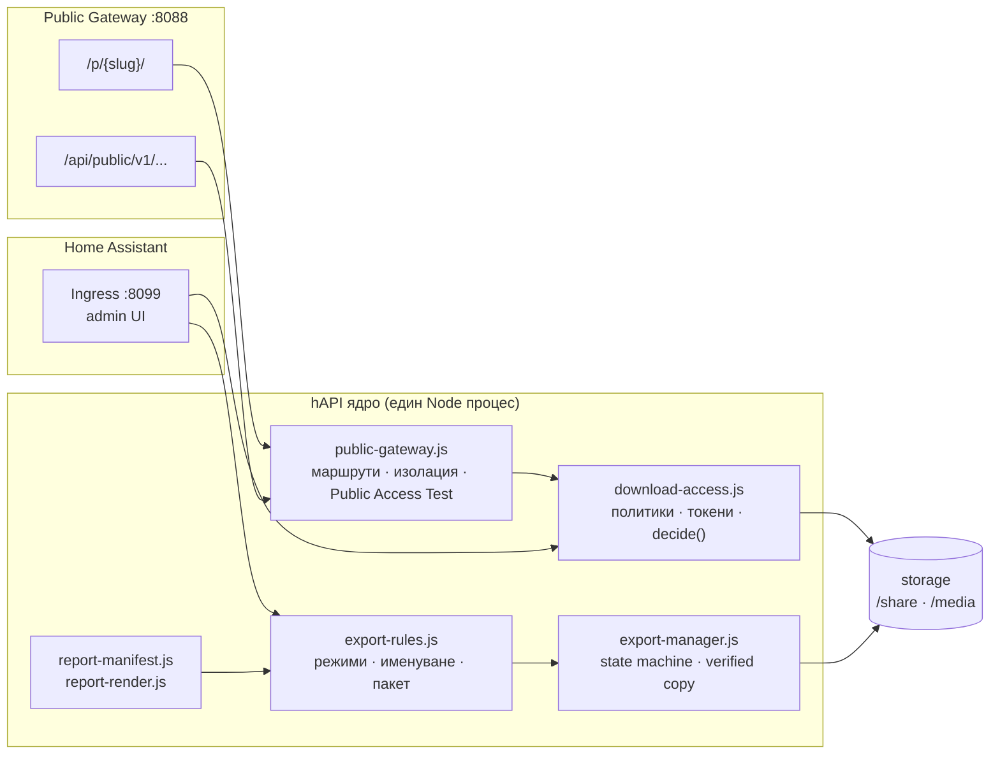

# hAPI ENTERPRISE — Обобщаващ общ план v7 (програмен план)

> **Статус:** действащ общ план. Това е единственият вход към всички останали планове:
> подрежда ги, показва какво е готово и какво следва. При конфликт между документи този
> план определя приоритета, а детайлите остават в специализираните планове.
> **Дата:** 2026-10-20 · **База:** v6.0 (`15-unified-master-plan-v6.0.md`).
> **Връзки:** [15](15-unified-master-plan-v6.0.md) · [16](16-implementation-plan-from-chat.md) ·
> [17](17-portal-files-management-plan.md) · [18](18-enterprise-control-center-plan.md) ·
> [19](19-file-delivery-export-manager-plan.md) ·
> [ADR-0024](../../documentation/03_ADR/ADR-0024-unified-project-v6.md) ·
> [ADR-0025](../../documentation/03_ADR/ADR-0025-report-studio.md) ·
> [ADR-0026](../../documentation/03_ADR/ADR-0026-public-gateway-and-digital-delivery.md)

---

## 1. Продукт и граници

**Един add-on „hAPI ENTERPRICE“** с два независими канала за достъп и едно ядро:

- **Home Assistant Add-on** — контролен център; администрация през Ingress.
- **Windows Edition** — същият интерфейс като самостоятелен прозорец (`.pyw` + WebView2), без
  браузър и без HTTP сървър.
- **Public API Gateway** — отделен порт/домейн, който обслужва само изрично публикувани
  портали и файлове, без HA сесия.
- **Report Studio** — манифестни отчети с `RFC 3161 START → модули → STOP` и доказателствен пакет.
- **File Delivery & Export Manager** — контролиран трансфер с проверка на SHA-256.
- **Download Access Control** — централни правила за достъпност, прилагани от backend-а.

Извън обхват: проекта `HASH_REPORT_ENTERPRICE` (`DROP`), външни SaaS услуги като задължителна
зависимост, геолокация без надежден източник.

### 1.1 Неподлежащи на обсъждане принципи

1. Публичният портал **не** изисква HA вход, когато е публичен; и **никога** не получава
   достъп до Ingress, Supervisor API или конфигурацията на HA.
2. GUI е чист JS (`file://`), без сървър; backend-ът прилага правата повторно при всяка заявка.
3. Нито един бутон не е декоративен — или работи, или е надписан „планирано“.
4. Доказателствените пакети винаги минават през проверка на SHA-256; презапис е забранен.
5. Всяка файлова операция се одитира; при прекъсване няма „успешен“ трансфер.
6. Manifest-driven Report Studio: START/STOP са първи/последен и заключени.

---

## 2. Карта на плановете

| План          | Обхват                                                                | Статус                                       |
| ------------- | --------------------------------------------------------------------- | -------------------------------------------- |
| 15            | Обединен roadmap v6.0 (фази 0–11), chat инвентар, качество, опаковане | ✅ приет                                      |
| 16            | Виртуално хранилище, API генерация, GUI серия W0–W5                   | ✅ W0–W5                                      |
| 17            | Портали → файлове → управление (F0–F9)                                | ✅ F0–F6, 🟡 F7 (F7-1/F7-3/F7-6), ❌ F9         |
| 18            | Enterprise Control Center: 15 панела, Report Studio (RS-01…RS-05)     | ✅ RS-01…RS-07, 🟡 RS-06 (PDF/A-3 без veraPDF) |
| 19            | File Delivery & Export Manager + Download Access Control (FD-0…FD-9)  | ✅ FD-0…FD-6, ❌ FD-7…FD-9                     |
| **20 (този)** | **Обобщаващ план v7: два канала, Public Gateway, ред на изпълнение**  | ✅ действащ                                   |

### 2.1 Горещи поправки след изданието

| Версия  | Какво поправя                                                                                                                                                                      |
| ------- | ---------------------------------------------------------------------------------------------------------------------------------------------------------------------------------- |
| 0.69.31 | Evidence порталът се публикува в HA `www`, а не в собствената папка на add-on-а (коренът се разпознава по `configuration.yaml`)                                                    |
| 0.69.34 | Панелът и генераторът работят под HA Ingress: адресът на API-то включва `/api/hassio_ingress/<token>` (INV-C1), а генераторът получава начални шаблони и показва реалната си папка |

---

## 3. Два независими канала за достъп

| Компонент      | Административен Ingress       | Публични API портали                          |
| -------------- | ----------------------------- | --------------------------------------------- |
| Предназначение | Управление на hAPI            | Предоставяне на файлове и услуги              |
| Достъп         | През Home Assistant           | През публичен URL                             |
| Автентикация   | HA сесия и допълнителни права | Публичен достъп, ключ или токен               |
| Потребители    | Администратори и оператори    | Външни посетители и API клиенти               |
| Изтегляне      | Управление и контрол          | Според политиката на файла                    |
| API            | Административно               | Ограничено публично API                       |
| Логове         | Административен одит          | Отделна история на посещенията и изтеглянията |

**Основно правило:** публичният портал не изисква HA вход, когато е публичен, и никога не
получава достъп до административния Ingress, Supervisor API или конфигурацията на HA.

### 3.1 Конфигурация на add-on-а (проектен пример)

```yaml
name: hAPI ENTERPRICE
slug: hapi_enterprice
version: 0.1.0
ingress: true
ingress_port: 8099
ingress_stream: true
panel_title: hAPI ENTERPRICE
panel_icon: mdi:api
panel_admin: true

ports:
  8088/tcp: null          # вътрешен; reverse proxy го обслужва на origin-а на HA

ports_description:
  8088/tcp: Public API Gateway

options:
  public_same_origin: true  # адресите са относителни → същият IP и порт като HA
```

- `8099` — само Ingress (администрация); `8088` — публичен gateway.
- Публичният порт **не се отваря автоматично**; външната достъпност изисква отделен HTTPS
  reverse proxy и собствен домейн (без смесване на cookies/сесии с HA).
- Примерът живее в `config/examples/addon-config.yaml`; реалният `hapi_enterprise/config.yaml`
  се променя само след решение за публикуване.

### 3.2 Изолация (задължителна)

| Правило                          | Прилагане                                                                                                                              |
| -------------------------------- | -------------------------------------------------------------------------------------------------------------------------------------- |
| Отделни listener-и               | ingress handler и public handler не споделят маршрути                                                                                  |
| Забранени пътища                 | `/config`, `/ssl`, `/backup`, `/addons`, `/admin`, `/hassio`, `/supervisor`, `/api/hassio`, `/api/services`, `/api/states`             |
| Минимални права върху файлове    | само `storage.allowed_roots` (`/share`, `/media`)                                                                                      |
| Само изрично публикувани ресурси | `portal.status === 'active'` + файл, наличен в портала                                                                                 |
| Отделна токен схема              | `hapi_…`; HA JWT (`eyJ…`) се отхвърля като публичен ключ                                                                               |
| Path traversal                   | отказ за `..`, `//`, абсолютни/UNC пътища, лош percent-encoding                                                                        |
| Един origin (по избор)           | `public_same_origin: true` → относителни адреси; reverse proxy маршрутизира `/p/` и `/api/public/` към `:8088`, всичко останало към HA |

---

## 4. Публични портали

Всеки портал е независим обект: `id`, `slug`, `title`, `status` (active/paused/disabled),
`access` (FREE/KEY_REQUIRED/AUTHENTICATED/PRIVATE/DISABLED), `visibility`, публичен HTML
(catalog/landing/none), read-only API, файлове с индивидуални права, токени (срок, брой
използвания, отзоваване), QR, статистика, `storage_root`.

### 4.1 Видимост × достъпност

| Видимост | Изтегляне    | Поведение                               |
| -------- | ------------ | --------------------------------------- |
| Public   | FREE         | Показва се и се изтегля свободно        |
| Public   | KEY_REQUIRED | Показва се, изисква ключ                |
| Hidden   | KEY_REQUIRED | Само с валиден адрес и ключ             |
| Hidden   | DISABLED     | Няма публичен достъп                    |
| Public   | DISABLED     | Показва се информационно, без изтегляне |

Йерархия: **system → storage → portal → folder → file → user/role → token → session**.
При конфликт печели по-строгото правило; файлова политика не може да е по-слаба от порталната.

> **Какво вижда посетителят** (id на портала, QR, резюме с брой файлове и обем, изписан адрес
> за изтегляне, действие „Изтегли“, опция за съобщение) е **договор**, не свободен избор:
> [`documentation/04_FUNCTION_SPECIFICATIONS/PORTAL_PAGE_CONTRACT.md`](../../documentation/04_FUNCTION_SPECIFICATIONS/PORTAL_PAGE_CONTRACT.md)
> (+ `tests/portal-page-contract.cjs`).

### 4.2 Публични адреси

```
https://portal.example.com/p/project-a/
https://portal.example.com/p/project-b/
https://portal.example.com/api/public/v1/portals/project-a
https://portal.example.com/api/public/v1/files/FILE_ID/download
```

При `public_same_origin: true` същите пътища са **относителни** и се отварят на адреса на
Home Assistant (`https://<HA-домейн>/p/…`, `/api/public/v1/…`), без отделен порт или домейн:
API-то работи на същия IP и порт като HA. Ръководство:
[`documentation/08_USER_GUIDES/public-gateway-setup.md`](../../documentation/08_USER_GUIDES/public-gateway-setup.md).

### 4.3 Public Gateway & Access (административен панел)

Секция в Ingress GUI: публични домейни, портали, API ключове, файлови политики, активни
връзки, ограничения, история и **Public Access Test** — симулация на външен посетител без
HA сесия, която показва дали файл е достъпен, изисква ключ или защо е отказан. Тестът не
разчита на това, което показва административният интерфейс.

---

## 5. File Delivery & Export Manager (резюме на план 19)

12 режима (single, selected, report, evidence, manifest, certificates, pdf, template, backup,
audit, bulk, verified), 8 категории съдържание, предвидимо име `RPT-YYYYMMDD-HHMMSS-CASE`,
`PACKAGE_INDEX.json` с `path/size/sha256/kind/source/verified`, проверка на SHA-256 (задължителна
за доказателствени режими), политика при конфликт (unique / skip+audit / abort), състояния
`QUEUED → PREFLIGHT → COPYING → VERIFYING → FINALIZING → COMPLETED` (+ FAILED / CANCELLED /
RECOVERY_REQUIRED), адаптери Windows/USB/NAS/HA/Browser зад един интерфейс.

### 5.1 Download Access Control (резюме)

5 режима, 8 нива на йерархия, права `files.read`, `files.download`, `reports.export`,
`evidence.export`, `templates.export`, `audit.export`, `backups.create`, `bulk.export`;
токени със срок/лимит/отзоваване; времеви прозорци, IP allow/deny, еднократни връзки,
rate limit и едновременни изтегляния. Report Studio артефакти: `DRAFT` PDF, окончателен PDF,
манифест, TSA токени, оригинали, Evidence Package — с отделни права и видим статус при
непълна проверка.

---

## 6. Архитектура (модули)



Публичният канал не вижда административните маршрути; административният канал не използва
публични токени.

---

## 7. Статус на модулите

| Компонент                             | Файл                                                                       | Статус                                                                                                                                                                                                                                                                                                                     |
| ------------------------------------- | -------------------------------------------------------------------------- | -------------------------------------------------------------------------------------------------------------------------------------------------------------------------------------------------------------------------------------------------------------------------------------------------------------------------- |
| Виртуално хранилище                   | `hapi_enterprise/virtual-storage.js`                                       | ✅                                                                                                                                                                                                                                                                                                                          |
| API спецификация и регистър           | `api-spec.js`, `api-registry.js`                                           | ✅                                                                                                                                                                                                                                                                                                                          |
| Report манифест / PDF                 | `report-manifest.js`, `report-render.js`, `report-stamp.js`, `cms-sign.js` | ✅ + PDF/A-3 структура, отделен CMS (PKCS#7) подпис, QR и TSA `.tsr`                                                                                                                                                                                                                                                        |
| Правила за експорт                    | `export-rules.js`                                                          | ✅ FD-0                                                                                                                                                                                                                                                                                                                     |
| Политики за достъп                    | `download-access.js`                                                       | ✅ FD-0                                                                                                                                                                                                                                                                                                                     |
| Публичен gateway модел                | `public-gateway.js`                                                        | ✅ PG-0 (модел, без listener)                                                                                                                                                                                                                                                                                               |
| Трансферно ядро                       | `export-manager.js`                                                        | ✅ FD-1                                                                                                                                                                                                                                                                                                                     |
| Конфигурация и схеми                  | `config/rules/*`, `config/schemas/*`                                       | ✅ 13 файла + `export-config.cjs`                                                                                                                                                                                                                                                                                           |
| GUI: Export Center / Gateway & Access | `ui/export-center.js`, `ui/public-gateway.js`                              | ✅ модели, проверени в браузър                                                                                                                                                                                                                                                                                              |
| GUI: Портали & файлове                | `ui/files-manager.js`                                                      | ✅ единен модул: карти за портали и файлове, контакт/дело/папка/полета по избор, API+QR при създаване, действия в изскачащи прозорци                                                                                                                                                                                        |
| GUI: стандарт на подредба             | `ui/styles.css`                                                            | ✅ всичко в проценти с равни обекти: `.u-grid` (действия/плочки/полета), `.u-row` (редове с бутони), грид заглавни редове; проверено 560–1400px без хоризонтален скрол                                                                                                                                                      |
| GUI: шрифтове                         | `ui/styles.css`                                                            | ✅ процентна скала `--fs-*` (html 100%, body 87.5%), без нито един `font-size` в px; явен monospace шрифт за `code`/`pre` срещу браузърната корекция 81.25%                                                                                                                                                                 |
| Пакет и PGP подпис                    | `packager.js`, `pgp.js`, `server.js`                                       | ✅ ZIP пакет (`PACKAGE_INDEX.json`, `hashes/sha256sum.txt`, манифест, оригинали) + автоподписване, изтегляне на ZIP/.asc и проверка; ключовете се **прикачат** (без генерация) в „Настройки → PGP ключ и автоподписване“, автоподписването е падащо меню след прикачване; **OpenPGP v4 + v6 (RFC 9580)**                    |
| GUI: навигация и настройки            | `ui/app.js`, `ui/settings-panel.js`, `ui/directory-panel.js`               | ✅ 9 панела (махнати празните обвивки), нови панели **Контакти** и **Дела**, настройки с поле за токен/адрес и публичен адрес за API/QR (`limits.publicBaseUrl`)                                                                                                                                                            |
| GUI: визуален стандарт v2             | `ui/styles.css`                                                            | ✅ компактни табелки `.chip` с точка за състояние, контрастни карти (`--card`, ляв акцент), филтри макс. 3 на ред, бутони на собствен ред (1 → ¼ вдясно, 2 → ½, 3 → ⅓, 4 → ¼)                                                                                                                                               |
| GUI: визуален стандарт v3             | `ui/styles.css`, `ui/files-manager.js`                                     | ✅ **един стил и големина** за `.chip/.flag-badge/.state-chip/.badge/.fm-ico` (височина `2em`), **без легенда на иконите**, разделителни ленти `.u-divider`, **икона на типа вместо чекбокс** пред файла (`.fm-pick`), пакет от цялото хранилище (`includeStorage`) и **пълен стек с хешове** (SHA-256/512, SHA-1, MD5)     |
| GUI: експлорер на папки               | `ui/files-manager.js`, `ui/styles.css`, `storage-tree.js`                  | ✅ папките от `storage_root` като скриващи се менюта (икона 📁/📂, име, брой файлове, общ обем), **отворена е само една папка**, файловете вътре с пълен път `/папка/файл.txt`, API+QR за всяка папка; картите на файловете остават непроменени                                                                               |
| GUI: портал на цял екран              | `ui/files-manager.js`                                                      | ✅ щракването отваря **само този портал** (списъкът се скрива), бутон **„← Списък с портали“** в края на страницата; филтрите и „Нов портал“ остават само в списъка                                                                                                                                                         |
| GUI: папки — създаване и коментари    | `ui/files-manager.js`, `server.js`, `storage-tree.js`                      | ✅ отделен ограден блок за папките (`.fm-folders-box`) и за файловете (`.fm-files-box`), „＋ Нова папка“ (`POST …/tree/folder`, празните папки се виждат), коментар към папка (`POST …/tree/comment`, `folderNotes` в дървото), файловете в папката в ограден списък                                                        |
| GUI: икони и флагове на папките       | `ui/files-manager.js`, `ui/styles.css`, `server.js`                        | ✅ заглавен ред с икони (📥 прикачи папка, ⤒ прикачи файл, ⏷ панел филтри), на всеки ред на папка 📥 добави файл, ⤓ пакет на папката, ▸/▾ разгъни и ⚙ меню (коментар · видима · медийна · заключване); качване на диска (`POST …/tree/upload`), флагове (`PATCH …/tree/folder`, `folderMeta`), пакет на папка (`storagePath`) |
| GUI: файлове по папка                 | `ui/files-manager.js`                                                      | ✅ „Файлове в портала“ показва файловете на **избраната папка** (заглавие с пътя); регистрираните файлове са с пълна карта, файловете само на диска — с карта „хранилище“ (път, размер, дата); коренът включва регистрираните файлове                                                                                       |
| Контакти и дела                       | `directory.js`, `cases.js`, `server.js`                                    | ✅ `/admin/api/directory/contacts`, `/admin/api/cases`; порталът пази `contactId`/`caseId`, публичният API не издава лични данни                                                                                                                                                                                            |
| Backend endpoints (реално прилагане)  | `server.js`, `gateway-api.js`                                              | ✅ FD-6/PG-6: правила, preflight, публичен listener :8088                                                                                                                                                                                                                                                                   |
| Публичен API на IP/порта на HA        | `custom_components/hapi_enterprise/__init__.py`                            | ✅ `/api/public/v1/…` на `:8123` (read-only, без HA сесия)                                                                                                                                                                                                                                                                  |
| Windows runtime (.pyw + WebView2)     | `hapi_enterprise/…`                                                        | ❌ W8                                                                                                                                                                                                                                                                                                                       |

---

## 8. Вълни на изпълнение

| Вълна | Съдържание                                                                      | Състояние                                                                                                                                                                         |
| ----- | ------------------------------------------------------------------------------- | --------------------------------------------------------------------------------------------------------------------------------------------------------------------------------- |
| W0    | Ядро, storage, виртуални пътища, тестове                                        | ✅                                                                                                                                                                                 |
| W1    | API генерация + административни endpoints                                       | ✅                                                                                                                                                                                 |
| W2    | Report Studio: манифест, PDF, A4 preview, Undo/Redo, обектна библиотека         | ✅                                                                                                                                                                                 |
| W3    | Правила за експорт + политики за достъп + gateway модел                         | ✅                                                                                                                                                                                 |
| W4    | Трансферно ядро + конфигурация/схеми + GUI модели                               | ✅                                                                                                                                                                                 |
| W5    | Портални файлове (план 17) върху `decide()`                                     | ✅ портали, папки, качване/регистрация, флагове, коментари (`ui/files-manager.js`, `portal-*.js`, `tree/*`); публичната страница е по договор                                      |
| W6    | Backend прилагане: preflight, jobs, gateway listen, Public Access Test сървърно | ✅ listener `:8088`, preflight, jobs, правила на живо                                                                                                                              |
| W7    | Report Studio: Evidence Package, DRAFT/INCOMPLETE, реални RFC 3161 токени       | ✅ `RS-05`/`RS-06`/`RS-07` + Evidence Package и статусите `READY`/`INCOMPLETE`/`DRAFT` (`report-package.js`, `tests/report-package.cjs`); остава само заверка на PDF/A-3 с veraPDF |
| W8    | Windows Edition, подпис на PDF, WebView2, опаковане                             | ❌ (подписът на PDF вече е готов в W7; остава Windows Edition)                                                                                                                     |

### 8.1 Следващите 10 работни слота

1. ✅ `config/rules/*` + `config/schemas/*` — декларативни правила и схеми (FD-0).
2. ✅ `export-manager.js` — state machine, preflight, verified copy, `PACKAGE_INDEX.json`, одит.
3. ✅ Тестове L1–L4 за правила, политики, gateway и трансфер.
4. ✅ `ui/export-center.js` — Export & Download Center (интерактивен модел).
5. ✅ `ui/public-gateway.js` — Public Gateway & Access + Download Access Policy + Public Access Test.
6. ✅ Навигация и стилове за двата панела.
7. ✅ Backend: `GET /admin/api/v2/export/rules`, `POST /admin/api/v2/export/preflight`.
8. ✅ Backend: gateway listener на `8088` + `GET /api/public/v1/files/{id}/download` през `decide()`.
9. 🟡 План 17: действията Преглед/Изтегли/Версии/… през `decide()` — режимите и
   проверката са в `download-access.js`, но „Премести“/„Копирай“ между портали още са
   надписани „планирано“ (`ui/files-manager.js`).
10. ❌ Report Studio: Evidence Package от манифеста + `DRAFT`/`INCOMPLETE` статуси
    (статусите съществуват само в `download-access.js`, не и в Report Studio).

**Готово в текущия етап:** FD-0/PG-0 (правила, политики, gateway модел), FD-1 (трансферно
ядро), конфигурация и схеми, два GUI панела, backend правила/preflight, отделен публичен
listener на `8088` с изолация, **същият IP и порт като HA** (`public_same_origin` +
интеграцията на `:8123`), 88 теста — `88/88` зелени.

**Публикуване на собствен домейн:** [`documentation/08_USER_GUIDES/public-gateway-setup.md`](../../documentation/08_USER_GUIDES/public-gateway-setup.md)
— DNS, add-on опции (`public_domain`, `public_gateway`), reverse proxy (NGINX/NPM/Cloudflare),
проверки с `curl` и таблица с чести проблеми.

---

## 9. Definition of Done (за всяка вълна)

1. `node scripts/run-tests.cjs` е зелен; новите модули имат собствен тест.
2. Няма фиктивни функции: всичко нереализирано е `capabilities.*.implemented = false` и се
   вижда като „планирано“ в GUI.
3. Документацията е обновена (план + ADR при архитектурно решение).
4. Сигурност: публичният канал не може да достигне административни пътища; правата се
   проверяват повторно в backend.
5. Съвместимост: Windows (дълги/UNC пътища) и Home Assistant (allowlist) не се разминават.
6. Одит: всяка операция оставя запис с операция, източник, цел, размер, хеш, статус, грешка.

---

## 10. Рискове и ограничения

| Риск                                   | Смекчаване                                                     |
| -------------------------------------- | -------------------------------------------------------------- |
| Публичен порт отворен по подразбиране  | `public.published: false`; ръчно публикуване + HTTPS           |
| Смесване на сесии HA ↔ публичен домейн | отделен домейн, без HA cookies                                 |
| `X-Forwarded-For` подправен            | IP правила само зад доверен proxy                              |
| SHA-256 ≠ произход                     | произходът се доказва с RFC 3161/подпис, не с хеша             |
| SMB/USB прекъсване                     | temp + verify + atomic rename; `RECOVERY_REQUIRED`             |
| Големи архиви                          | части и компресия — отделни capabilities със собствени тестове |
| GUI като „контрол“                     | всички решения се вземат повторно в backend                    |
