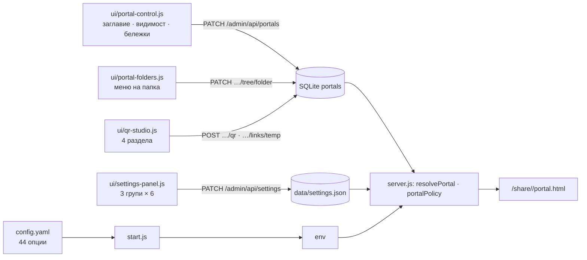
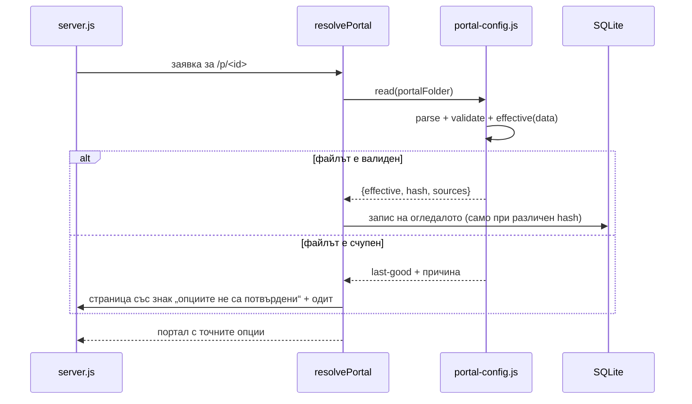
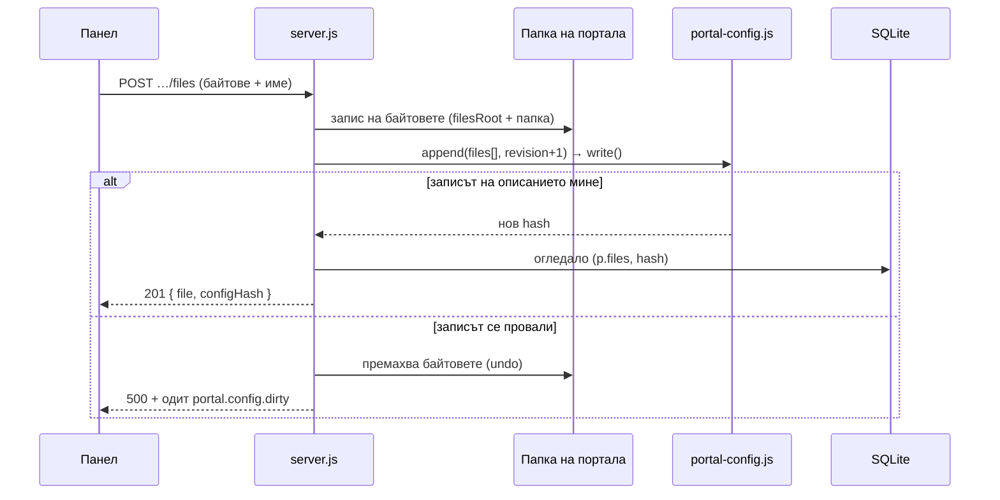

# План: `configuration.yaml` на портала — опциите живеят до файловете

> **Клас:** план · **Обхват:** портали, достъп, QR, папки, интерфейс · **Проверен срещу код:** 0.69.231
>
> **Идеята в едно изречение:** всяка папка на портал носи своя `configuration.yaml`, в който
> е ЦЯЛОТО състояние на портала — опции, флагове на папките, QR и регистърът кой файл къде е —
> за да може порталът да бъде разпознат, зареден и показан в панела точно както е бил, дори
> когато базата е нова, копие е пренесено на друга машина или човек е отворил папката в Home
> Assistant.
>
> Документът е проучване + план за изпълнение. Нищо в него не е внедрено.

## 1. Проблемът днес

Опциите на един портал са разпръснати в **четири** места, които не се знаят едно за друго:

| Къде | Какво пази | Кой пише | Кой чете |
| --- | --- | --- | --- |
| База `portals` (SQLite) | `visibility`, `access`, `branding`, `folderMeta`, `folderNotes`, `notes`, `subject`, `category`, `flag`, `parentId` | `POST/PATCH /admin/api/portals`, `PATCH /admin/api/portals/<id>/tree/folder` (`routes/folders.js:78-105`) | `server.js:593` (`adminPortal`), `folderMetaOf` (`server.js:625`), `routes/portal-storage.js:138,268`, `routes/upload-sessions.js:125` |
| Файлове в базата | `accessMode` (FREE/KEY_REQUIRED/DISABLED), `listed` | качване/PATCH на файл (`server.js:2400+`) | `routes/portal-storage.js`, `download-access.js` |
| Глобални настройки | `requirePortalToken`, лимити, retention, preview, сензори | `/admin/api/settings` (`server.js:1015-1027`) → `runtime-config.js` | целият сървър през `runtime.effective()` |
| Опции на add-on-а | 44 опции от `config.yaml` (`option-spec.js`) | Home Assistant | `start.js` при старт |

Последиците, които виждаме днес:

1. **Папката не се самодокументира.** `/share/<slug>` съдържа файловете и генерирания
   `portal.html`, но не казва нищо за достъпа, видимостта или QR поведението. Човек, който
   отвори папката през Samba/HA, не може да разбере защо дадена папка е скрита или заключена.
2. **Възстановяване от папка е невъзможно.** Копиране на `/share/<slug>` в друга инсталация
   връща файловете, но не и опциите — порталът се вдига с подразбиранията и изглежда различно.
3. **Две истини за едно и също.** `folderMeta` се пише в базата, а `folderNotes` до него — в
   друго поле; `readonly` е трето (дъщерен портал през `portalView.ensureView`), а QR нивата се
   смятат в панела (`files-manager.js:1038`) — сървърът не знае какво е избрал човекът.
4. **Опциите не се виждат, преди да се отвори правилният блок.** Те са в „Контролен панел“
   (`ui/portal-control.js`), в менютата на папките (`ui/portal-folders.js`) и в QR студиото
   (`ui/qr-studio.js`) — три различни начина за едно и също решение „как да се държи порталът“.
5. **Никой не проверява, че избраното е приложено.** `tests/*` пазят маршрутите, но няма
   тест, който да твърди „порталът, зареден от тази папка, има ТЕЗИ опции“.

## 2. Днешна карта (as-is)



Изводът: **сървърът е единственият, който знае всичко**, но знанието е в база, която не
пътува с портала. Файлът на портала е само изход (генерирана страница), не вход.

## 3. Целеви модел (to-be)

- **`configuration.yaml` е декларацията.** Стои в корена на папката на портала и съдържа
  ВСИЧКИ опции, включително QR. Пише се от панела; човек може да го редактира и на ръка.
- **Един портал = една папка = един `configuration.yaml`.** Файлът стои в САМАТА папка на
  портала и е единственият източник на опциите му — включително флаговете на вътрешните
  папки (видима/медия/заключена), записани в същия файл по път. Няма файлове в подпапките и
  няма наследяване между папки: едно място за четене, едно място за запис, нула двусмислие.
- **Една посока на истината:** файл → база. Базата остава това, което сървърът чете бързо
  (индекси, търсене, връзки), но се смята за **огледало** на файла. Ръчна промяна на файла се
  вдига при следващия прочит (mtime + sha256), а не при рестарт.
- **Всичко е видимо:** панелът показва ефективните стойности („наследено от портала“ /
  „зададено тук“), а не само това, което е записано локално.
- **Порталът знае себе си:** `GET /admin/api/portals/<id>/options` връща
  `{file, hash, effective, sources}`; страницата на портала и QR студиото четат оттам, не
  пресмятат сами.

### 3.1 Хранилището: нищо в `/share`, всичко в `/share/hAPI`

Днес add-on-ът пише в корена на логическия дял: порталът получава подпапка направо в
`/share/hapi/data/root_storage` (`paths.js:48,54`), тоест името на хранилището (`hapi`) и
името на папката на порталите (`root_storage`) са два различни езика за едно и също. Планът
въвежда ЕДНО име на входа и ЕДНА папка по подразбиране за всичко, свързано с портали:

```
<логически корен>/                 ← /share, /media или /addon_configs/… (изборът в опциите)
└── hAPI/                          ← ЕДИНСТВЕНОТО място, в което add-on-ът пише
    ├── portals/                   ← папка по подразбиране за порталите
    │   └── <slug>/                ← папката на един портал
    │       ├── configuration.yaml ← опциите на портала (този план)
    │       ├── portal.html        ← генерирано
    │       ├── api.json · openapi.json
    │       └── …потребителски папки/файлове (флаговете им са в configuration.yaml на портала)
    ├── data/                      ← база и настройки (днес `/share/hapi/data`)
    ├── backups/
    ├── exports/
    └── qr-records/
```

Правилата, които стават закон и се пазят от тест:

1. **Никакъв запис в корена** (`/share/configuration.yaml`, `/share/<slug>` и подобни са забранени).
   Единственият вход е `<корен>/hAPI`, а той се строи САМО в `paths.js`.
2. **Всичко, свързано с портали, има папка по подразбиране** — `hAPI/portals`. Нов портал без
   изричен `storage_root` получава `hAPI/portals/<slug>`; никой модул не строи този път сам.
3. **Регистърът е важен:** на HA `/share` е чувствителна към регистъра файлова система, тоест
   `hapi` и `hAPI` са различни папки. На Windows (NTFS) са една и съща — затова тестовете
   работят с временен корен (`tests/helpers.cjs#storageRoot()`), а миграцията е ПРЕМЕСТВАНЕ с
   проверка, не „преименуване на сляпо“.
4. **Езикът на пътищата е един:** `paths.hapiHome()` → `<корен>/hAPI`;
   `paths.portalsRoot()` → `<корен>/hAPI/portals`; `STORAGE_DEFAULTS.subdirectory` става
   `'hAPI/data'`, а `PORTAL_STORAGE_SUBDIR` — `'portals'`.

**Съответствие старо → ново:**

| Днес | Утре | Какво се случва с данните |
| --- | --- | --- |
| `/share/hapi/data` (база, настройки) | `/share/hAPI/data` | Преместване на цялата папка при старт, ако новата липсва; одит `storage.home.migrated` |
| `/share/hapi/data/root_storage/<slug>` | `/share/hAPI/portals/<slug>` | Преместване на всяка папка на портал; `storage_root` в базата се обновява на `hAPI/portals` |
| `/share/USB/…` (избран друг дял) | `/share/USB/hAPI/…` | Същото правило, но под избрания корен — `hAPI` е винаги първата папка |
| `/media` или `addon_config` като локация | `<този корен>/hAPI/…` | Без изключение: името не зависи от мястото |

Миграцията е идемпотентна (`scripts/migrate-hapi-home.cjs`): ако `hAPI` вече съществува,
нищо не се пипа; ако и двете съществуват — НЕ се сливат на сляпо, а се спира със списък на
разликите. Старата папка остава с маркер `MIGRATED-TO-hAPI.txt` (обяснение + дата), за да не се
обърка човек, който я види през Samba.


## 4. Договор на файла

**Място и име:** `<root>/hAPI/portals/<slug>/configuration.yaml` — САМО там, един файл на
портал. В подпапките на портала няма `configuration.yaml`: флаговете им се пазят в същия файл,
в секцията `folders.items`. Коренът се взима през `paths.resolveStoragePath()` (никога
`path.resolve('/share')`, вж. `tests/storage-roots.cjs`).

**Формат:** UTF-8, **LF**, `version: 1` задължителен, глава с коментар „пише се от панела“.
Кодиране без тайни: никакви токени, пароли или ключове — те остават в базата/`secrets.yaml`.

**Пример (корен на портала):**

```yaml
# hAPI портал · /share/hAPI/portals/lichni-dokumenti/configuration.yaml
# Опциите пътуват с папката. Пише се от панела (Опции).
version: 1
revision: 12                 # расте с 1 при всеки запис (If-Match и проверка)
updated_at: 2026-11-16T20:21:00Z
portal:
  slug: lichni-dokumenti
  title: Лични документи
  visibility: private        # radio: public | private
  flag: none                 # radio: none | важено | заключено | …
access:
  mode: key                  # radio: free | key | token
  review_only: false         # checkbox
  download_requires_key: true
  temporary:
    default_ttl: 24h         # radio: 1h | 6h | 24h
    default_read_only: true
    password_required: false
qr:
  style: frame               # radio: frame | plain
  caption: url               # radio: url | title
  levels:
    folder: true
    file: true
  archive_on_change: false
folders:
  defaults:
    visible: true
    media: false
    locked: false
  items:                       # само папките, които се различават от defaults
    "/2026":
      locked: true
      reason: „приключени дела — само за четене“
    "/вътрешно":
      visible: false
storage:
  subpath: ""                  # празно = собствената папка на портала (под hAPI/portals)
  copy_to_folder: true         # качените файлове се виждат и в папката
files:                         # РЕГИСТЪР: кой файл къде е — това, което панелът показва
  - id: 9f2c41ab
    path: "/2026/договор.pdf"  # път в папката на портала
    size: 184320
    sha256: 3f9a…
    version: 1
    access: key               # free | key | disabled
    listed: true
    mirror: false
    added: 2026-11-16T20:19:00Z
    modified: 2026-11-16T20:19:00Z
ui:
  columns: 3
  show_sizes: true
audit:
  telemetry: true
```

**Схема (съкратено; пълната таблица влиза в `PORTAL_OPTIONS_CONTRACT.md`):**

| Ключ | Тип | Подразбиране | Днес живее в | Контрол в панела |
| --- | --- | --- | --- | --- |
| `portal.visibility` | `public \| private` | `private` | `portals.visibility` | радио (2) |
| `access.mode` | `free \| key \| token` | от `visibility` | `portals.access` + `PORTAL_TOKEN` | радио (3) |
| `access.review_only` | bool | `false` | `portalView.ensureView` (дъщерен портал) | чекбокс |
| `access.download_requires_key` | bool | `true` | `download-access.js` | чекбокс |
| `access.temporary.*` | срок/флагове | `24h`, read-only | `qr-studio.js` + токени | радио + чекбокс |
| `qr.style`, `qr.caption` | избор | `frame`, `url` | `qr-studio.js` | радио |
| `qr.levels.folder/file` | bool | `true` | смята се в `files-manager.js:1038` | чекбокс |
| `folders.defaults.visible/media/locked` | bool | `true/false/false` | `p.folderMeta` | чекбокс |
| `folders.items."<път>"` | обект | — | `p.folderMeta[път]` | меню на папката (пише същия файл) |
| `storage.subpath`, `storage.copy_to_folder` | низ/bool | `""`, `true` | `p.storage_root`, `portal_folder_copy` | текст/чекбокс |
| `files[]` | списък от обекти | `[]` | `p.files[]` (id, name, sha256, accessMode, listed, storagePath, mirror) | списък с брошки и меню на файл |
| `ui.columns`, `ui.show_sizes` | число/bool | `3`, `true` | днес твърдо в UI | радио/чекбокс |
| `audit.telemetry` | bool | `true` | `p.telemetry` | чекбокс |

**YAML подмножество (важно заради нула зависимости):** `configuration.yaml` се чете от
собствен, строг четец в новия модул `portal-config.js` — обекти до 4 нива, скалари, bool,
числа, списъци от скалари и **списък от обекти с фиксиран ред на ключовете** (`files:`), плюс
коментари. **Забранени:** табулация, дублиран ключ, anchors, aliases, многоредови блокове,
изрази. Тестът прави обратен прочит (parse → stringify → parse) и изисква байт-идентичен
резултат. Това е съзнателно ограничение: файлът е конфигурация, не програма. Ключовете на
`folders.items` се пишат в кавички (пътят съдържа `/`), а стойностите — само скалари; това е
единственото „странно“ нещо в подмножеството и то се проверява от теста.

## 5. Приоритет и една истина

```
подразбирания (код)  <  configuration.yaml на портала  <  запис на конкретен файл
```

- Има САМО един файл на портал. Флаговете на папките са в него (`folders.defaults` +
  `folders.items`), а не в отделни файлове — затова няма как две папки да си противоречат
  или да наследяват нещо невидимо.
- `files[]` е част от СЪЩИЯ договор: качването не е „запис на конкретен файл“, а промяна на
  описанието (новият ред в `files`) ЗАЕДНО с байтовете; `p.files` в базата е огледало, а
  историята на версиите остава само там.
- **Изтрит ключ = подразбиране**, не „последната стойност от базата“. Това е правилото, което
  пази една истина; иначе базата става втори автор.
- При конфликт файл vs база печели **файлът**, а разликата се вдига като одит
  `portal.config.conflict` (веднъж на промяна, не на заявка).

## 6. Как се зарежда (сървър)



- Кеш: по `mtime` + `sha256` на файла; при промяна се пре-чете веднага (без рестарт).
- Счупен файл **не сваля портала**: зарежда се последното валидно, показва се видим знак и се
  пише одит `portal.config.invalid`. Нов портал без файл получава **safe defaults** (`private`).
- Точки на включване: `resolvePortal` (единственото място, което решава кой е порталът),
  `portalPolicy` (достъп), `routes/portal-storage.js` (папки/файлове), QR издаване, `portal.html`.
- **Регистърът пристига със същия прочит:** `files[]` дава на панела дървото, списъка и брошките
  без отделни заявки. Сверката с диска е отделна операция (`verify`), защото иска обхождане на
  папката и не бива да товари всяко отваряне.

## 7. Интерфейс — опростена, структурирана среда

**Един блок „Опции“ в картата на портала** (до „Контролен панел“), с четири раздела, всеки от
които отговаря на един въпрос:

1. **Портал** — как се казва и кой го вижда: заглавие, видимост (радио), флаг (радио).
2. **Достъп** — как се влиза: режим (радио: свободен/ключ/токен), „само за преглед“ (чекбокс),
   изтегляне с ключ (чекбокс), временни връзки (радио срок + чекбокси).
3. **QR** — как изглежда кодът: рамка/обикновен (радио), надпис адрес/заглавие (радио), кои
   нива получават код (чекбокси), архив при промяна.
4. **Папки** — как се държат папките по подразбиране (видима/медия/заключена) и списък на
   изключенията (коя папка се различава и защо). Менюто на папката пише СЪЩИЯ файл — не създава
   втори.

Долу в блока: **жива разпечатка на `configuration.yaml`** (само за четене), един бутон
„Запиши в папката на портала“ и ред „файл: `/share/hAPI/portals/<slug>/configuration.yaml` —
променен в 14:03“. Папка с ред в `folders.items` носи брошка „собствени флагове“; няма второ
трето състояние, което да се бърка с наследено.

Правилата на хранилището остават непокътнати: блокът е ВЪТРЕ в портала (не нов раздел в
менюто — пази се симетрията `NAV_GROUPS` 4×4), етикетите идват от `field-labels.js`, текстовете
— от `i18n.js` (BG/EN/DE), а новите модули влизат в `UI_FILES` и в тавана на
`tests/ui-i18n-ratchet.cjs`. Подредбата НЕ се решава тук: тя е по
`docs/plan/24-ui-positioning-rules.md` — име отляво, опции в десния край, четири равни раздела.

### 7.1 Какво става по-лесно в GUI, когато файлът носи всичко

| Днес | След промяната |
| --- | --- |
| дървото се строи от `files` + `tree` + `folderMeta` (три заявки) | едно `GET …/options` дава дървото, флаговете и файловете |
| „къде е файлът“ се смята в панела | `files[].path` е записан; панелът само го показва |
| няма проверка, че папката отговаря на портала | бутон „Провери папката“ — липсващи / излишни / сменени файлове с `sha256` |
| търсене и филтри искат допълнителни заявки | търсенето е върху заредения регистър (локално, мигновено) |
| експорт/импорт на портал няма | „изтегли описанието“ / „внеси описание“ — един YAML файл |
| преместване на портал в друга инсталация губи опциите | копира се папката и порталът се вдига с всичко |

## 8. Един записващ

Нов модул `hapi_enterprise/portal-config.js` (изисква ред в `Dockerfile COPY` и в `CRITICAL` на
`integrity.js`):

| Функция | Договор |
| --- | --- |
| `read(folderAbs)` | `{ data, hash, error }`; чете само `configuration.yaml`, отказва symlink |
| `validate(data)` | строга схема; непознат ключ = грешка с име на ключа |
| `effective(data)` | подразбирания + файл → ефективните стойности и откъде идва всяка (`sources`) |
| `write(folderAbs, data)` | атомично (`tmp` + `rename`), LF, права `0600`, одит `portal.config.saved` |
| `verify(folderAbs, data)` | сверява `files[]` с диска: липсващ / излишен / променен (`sha256`) |
| `diff(a, b)` | какво точно се променя — за одита и за UI |

Пише **само** този модул. Маршрутите (`routes/folders.js`, `routes/portal-tokens.js`) и
панелът не пишат файла директно — иначе се връща класът на DEF-63/DEF-81 (два автора на един
договор).

## 9. Сигурност и откази

- Няма тайни във файла: `token`, `password`, `pgp_*` остават в базата/`secrets.yaml`; проверка
  за шаблони `sk-`, `ghp_`, `eyJ` при запис → отказ (същият скенер като `diag-package`).
- Пътят се проверява с `path.resolve` + префикс на папката на портала; `..` и абсолютни пътища
  се отказват (`400`).
- Файлът е **генериран/служебен**: влиза в `isGenerated()` на `portal-folder.js`, за да не се
  показва като съдържание и да не се брои във файловете на портала.
- Размер: таван 64 KB; над него — отказ с обяснение.
- Счупен/непознат файл никога не се „поправя“ мълчаливо: порталът работи с последното валидно
  и показва знак, а панелът дава „виж грешката на реда N“.

## 10. Миграция (пет стъпки, всяка със свой гейт)

| Фаза | Какво влиза | Критерий за преминаване |
| --- | --- | --- |
| **0. Хранилище** | `<root>/hAPI` като единствена входна точка; `portals/` е папката по подразбиране за портали; нищо не се пише в корена; миграция на `/share/hapi/data/root_storage` | `storage-namespace.cjs`, `storage-roots.cjs` зелени; стара серия мигрира без загубен файл |
| **1. Четене** | `portal-config.js` (read/validate/effective), `GET …/options`, генериране на файл при създаване на портал, `isGenerated` | `portal-config-format.cjs`, `portal-config-folders.cjs` зелени; нито един съществуващ тест не пада |
| **2. Огледало** | файл → база (една посока), одит при конфликт, ръчна редакция се вдига по mtime | `portal-config-precedence.cjs`, `storage-roots.cjs`, `folder-delete.cjs` зелени |
| **3. Интерфейс** | блок „Опции“ (4 раздела), флаговете на папките в същия файл; `--only=portal-config` | `gui-portal-options.cjs`, `ui-nav-symmetry.cjs`, `ui-i18n-ratchet.cjs`, `field-labels` зелени |
| **4. Оттегляне на двойника** | `folderMeta` остава само проекция; PATCH на папка пише файла | `portal-config-failclosed.cjs`; ръчен smoke: копиране на папка в нова инсталация връща същите опции |

Обратен път: фази 1–2 са обратими (файлът се игнорира с `HAPI_PORTAL_CONFIG=off`); чак фаза 4
прави файла задължителен.

## 11. Тестове и порти

- `tests/portal-config-format.cjs` — обратен прочит, LF, табулация/дублиран ключ/anchors се
  отказват; непознат ключ не минава тихо.
- `tests/portal-config-folders.cjs` — флаговете на папките са в `folders.defaults`/`folders.items`
  на файла на портала; менюто на папката пише същия файл, не втори; изтрит ред връща
  подразбирането, не старата стойност.
- `tests/portal-config-precedence.cjs` — файл печели срещу база; конфликтът влиза в одита.
- `tests/portal-config-failclosed.cjs` — счупен файл: порталът работи с last-good, знае се, че
  не е потвърден; нов портал получава `private`.
- `tests/gui-portal-options.cjs` — радио/чекбокс промяна → записан YAML (сравнение байт по байт),
  „наследено“ не се записва като стойност.
- `tests/storage-namespace.cjs` — никакъв запис в корена `/share` (само `/share/hAPI/…`);
  порталът по подразбиране живее в `hAPI/portals/<slug>`; нито един модул не строи път
  `<корен>/<slug>` напряко.
- Допирани съществуващи: `storage-roots.cjs`, `folder-delete.cjs`, `file-placement.cjs`,
  `docker-runtime.cjs` (COPY), `integrity-startup.cjs` (`CRITICAL`), `ui-*`, `source-inventory`,
  `docs-index`, `scenario-matrix`, `regression-guards` (нов ред за дефект, ако затворим такъв).

## 12. Рискове

| Риск | Защо е реален | Отговор |
| --- | --- | --- |
| Две истини (файл и база) | вече сме го преживели с адресите (DEF-63/DEF-69) | една посока, одит при конфликт, тест за приоритет |
| Собствен YAML четец | грешен парсер чупи опции | малко подмножество + обратен прочит + отказ вместо догадка |
| Ръчна редакция с табулация | най-честата грешка при YAML | ясна грешка с ред и знак, не мълчалив пропуск |
| Файлът се качва като съдържание | `/share` е и папка с файлове | `isGenerated()` + тест, че не се показва |
| Ръст на `server.js` | твърд таван 2722 реда | цялата логика в `portal-config.js`; сървърът само вика |
| Запис при ВСЯКА мутация | 200 качени файла = 200 записа по SMB | групов запис веднъж на операция + журнал за недовършен запис |
| Разминаване на регистъра с диска | човек мести/трие файл през Samba | `verify` със „липсващ/излишен/променен“ и брошка в списъка; не е фатално |
| Големи портали | 10 000 файла в един YAML | таван 4 MB / 5 000 записа с ясно съобщение; над това — отделен дял или разделяне |

## 13. Изходни решения (преди фаза 1)

> Задълбоченият анализ е в §14–§23, схемата и договорите — в §25–§28, планът за фаза 1 — в
> §29–§30, а решенията по подразбиране — в §31.

1. **Потвърдено:** един портал = една папка = един `configuration.yaml`; в подпапките няма
   файлове, а флаговете им живеят в секцията `folders` на портала.
2. **Кой печели при ръчна редакция?** Планът: файлът (базата е огледало).
3. **`access.mode` = `token`** — това е глобалната опция `require_portal_token`; тук тя става
   избор за конкретния портал. Потвърждение: искаме ли порталът да може да я отменя?
4. **QR настройките** — само оформление и нива, или и срок/парола по подразбиране за временните
   връзки?
5. **Език на ключовете** — английски ключове, български стойности? Планът: английски ключове
   (един договор за код и файл), стойностите са избори.
6. **Име на папката** — `/share/hAPI` точно така (главни „API“) и `hAPI/portals`. На HA
   файловата система е чувствителна към регистъра: `hapi` и `hAPI` са две различни папки,
   затова преминаването е ПРЕМЕСТВАНЕ с проверка, не преименуване „на сляпо“.
7. **Какво става със стария корен** — `/share/hapi/data/root_storage` се мести в
   `hAPI/portals` и се оставя указател/одит, или се чете като наследен (legacy) до изтриване?

## 14. Задълбочен анализ — граници на договора

### 14.1 Какво влиза във файла: ЦЯЛОТО състояние

Файлът не е „настройки до портала“ — той е **описанието на портала**: всичко, което панелът
знае и показва, плюс регистъра кой файл къде е.

| Във файла | Защо е там |
| --- | --- |
| идентичност, видимост, флаг, тема/категория, бележки | това е картата на портала |
| режим на достъп, „само за преглед“, изтегляне с ключ, временни връзки | поведението при вход |
| флагове на папките (`visible`, `media`, `locked`, `reason`) | дървото се рисува без допълнителни заявки |
| `files[]` — id, път, размер, sha256, версия, `access`, `listed`, `mirror`, дати | списъкът и търсенето работят от един прочет |
| `storage` — подпът и видимост в папката | знае се къде живеят байтовете |
| QR — оформление, надпис, нива, архив | кодът се строи от същия източник |
| UI избори (колони, размери) | панелът се възстановява както е бил |

**Какво НЕ влиза (и защо):**

| Извън файла | Причина |
| --- | --- |
| токени, пароли, хешове на ключове | тайни — мястото им е в базата/`secrets.yaml` |
| история на версиите на файл, одитен дневник, телеметрия | това е **минало**, а файлът описва **сега**; историята се пази в `audit-chain` и `p.files[].versions` |
| печати и ревизии на QR (`qrRegistry`) | история на кодовете, не тяхното оформление |
| контакт/дело като обект | във файла влиза само идентификаторът; самите записи живеят в регистъра |

Правилото: **файлът е състоянието, не журналът.** Всяко нещо, което панелът показва като
„сега“, е във файла; всичко, което показва като „кога/колко пъти“, остава в одита. Така файлът
не расте с времето, а само с броя на файловете — и може да бъде сверен с папката.

### 14.2 Дескрипторът на опциите (по модела на `option-spec.js`)

Днес 44-те опции на add-on-а живеят в един дескриптор (`hapi_enterprise/option-spec.js`), от
който се раждат `config.yaml`, преводите, таблиците в README и тестът `option-effects.cjs`.
Този модел съществува, защото вече сме горяли: DEF-90 беше „документацията твърди, че опцията
не се чете, а кодът я чете“. Същият клас дефект чака и порталните опции, ако ги опишем на пет
места на ръка.

Затова и тук има **един дескриптор** `hapi_enterprise/portal-options-spec.js`:

```js
{ key: 'access.mode', type: 'enum', values: ['free', 'key', 'token'],
  default: (ctx) => (ctx.visibility === 'public' ? 'free' : 'key'),
  control: 'radio', order: 2, i18n: 'po.access.mode', reader: 'portal-policy.js' }
```

От него произлизат: (1) валидацията; (2) контролите в панела (радио/чекбокс/избор и ред);
(3) ключовете за превод; (4) таблицата в документацията; (5) тестът „всяка опция има читател“.
Ако ключ няма `reader`, тестът пада — така „декоративна настройка“ не може да влезе.

### 14.3 Опция → къде се прилага → какво я доказва

| Опция | Прилага се в | Тест, който пада без нея |
| --- | --- | --- |
| `portal.visibility` | `portal-policy.js` (публичен/частен вход) | `portal-config-effects.cjs` §1 |
| `access.mode` | `portal-policy.js` + `requirePortalToken` | §2 (три режима, три отказа) |
| `access.review_only` | `portal-view.js#ensureView` (създава/маха спътника) | §3 (двойник има/няма) |
| `access.download_requires_key` | `download-access.js` | §4 |
| `access.temporary.*` | `routes/portal-tokens.js` (подразбирания в QR студиото) | §5 |
| `qr.*` | `ui/qr-studio.js` + `portal-qr.js` | §6 (стил/надпис/нива) |
| `folders.defaults/items` | `server.js#folderMetaOf` + `routes/portal-storage.js` | §7 (скрита/заключена папка дава 404) |
| `ui.columns`, `ui.show_sizes` | панелът | §8 |
| `audit.telemetry` | `recordTelemetry` | §9 |

## 15. Животен цикъл на файла

### 15.1 Четене

- Пътят се строи веднъж (`paths.portalConfigPath(portal)`); четенето е `lstat` → отказ при
  symlink → `readFile` (таван 4 MB, предупреждение над 1 MB) → `sha256`.
- Кеш: `{ mtimeMs, size, sha256, data, effective }` по абсолютен път. При заявка първо `stat`:
  същите `mtimeMs` и `size` → кешираното. Различни → ново четене и хеш.
- **Капанът на споделената папка:** `/share` на HA е мрежова/споделена файлова система и
  `mtime` може да е с гранулация 1 s, а клиентът да кешира атрибути. Затова: (а) при запис през
  панела кешът се обновява директно от записаното тяло (без чакане на `stat`); (б) админ API-то
  приема `?fresh=1`, който чете винаги; (в) панелът има „Презареди от файла“.
- Грешка при четене не хвърля към заявката: връща се `{ error, lastGood }` и порталът зарежда
  последното валидно.

### 15.2 Запис

- Атомично: `configuration.yaml.<pid>.tmp` в СЪЩАТА папка → `fsync` → `rename` върху целта.
  На Windows `rename` върху съществуващ файл е `MoveFileEx(REPLACE_EXISTING)` — работи, но ако
  файлът е отворен от Samba/редактор, дава `EPERM/EBUSY`; затова 3 опита по 50 ms и ясна грешка
  „файлът е отворен в друга програма“ (не 500 без обяснение).
- Права `0600` (файлът съдържа заглавия и бележки — лични данни), собственик — процесът на
  add-on-а. Папката остава каквато е (не пипаме права на потребителски папки).
- В процеса: ключалка по абсолютен път (`Map<path, Promise>`), за да не се смесят два записа
  от два таба.
- LF при запис; при четене CRLF се приема (човек редактира на Windows) — това е единственото
  място, където „строго LF“ е само за писане.
- **Всяка промяна на портала = ново съдържание на файла.** Качване, изтриване, преместване,
  смяна на достъп или на флаг минава през ЕДИН път: мутирай → `revision += 1` → запиши файла →
  обнови огледалото в базата. Групово качване пише ВЕДНЪЖ накрая (транзакция на ниво операция),
  не веднъж на файл — иначе 200 файла дават 200 записа по SMB.
- Ако записът на файла се провали, байтовете се връщат назад (`undo`) и отговорът е грешка, а
  не „полузаписан портал“; ако байтовете са записани, а файлът не — има задача за повторен запис
  (`portal.config.dirty`), която се пуска при следващата промяна и при старт.

### 15.3 Конфликт между две сесии (чекпойнтът, който потребителят иска)

Панелът пази `hash` на файла, който е прочел. Записът носи `If-Match: <hash>`:

- съвпада → записва, връща новия `hash`;
- не съвпада → `409` с `{ currentHash, diff }`; панелът показва **какво е променено междувременно**
  (файлът е пипан на ръка или в друг таб) и иска решение: „Презареди“ · „Презапиши моето“;
- „Презапиши моето“ е съзнателно действие, не мълчаливо — точно това е чекпойнтът: човек
  вижда, преди да загуби чуждо решение.

## 16. Матрица на отказите

| Състояние на файла | Какво зарежда порталът | Какво вижда човекът | Одит | Тест |
| --- | --- | --- | --- | --- |
| липсва | подразбирания | „няма описан файл“ + бутон „Създай от текущите настройки“ | `portal.config.missing` | `failclosed` §1 |
| невалиден YAML | последно валидно | знак „опциите не са потвърдени“ + ред и колона | `portal.config.invalid` | §2 |
| непознат ключ | последно валидно | „непознат ключ `x.y` на ред N“ | `portal.config.unknown_key` | §3 |
| грешен тип/стойност | последно валидно | „очаква се едно от: …“ | `portal.config.invalid` | §4 |
| по-нова версия (`version: 2`) | последно валидно | „файлът е от по-нова версия — не го презаписвам“ | `portal.config.newer` | §5 |
| > 4 MB или > 5 000 файла в регистъра | последно валидно | „описанието е твърде голямо“ | `portal.config.too_big` | §6 |
| symlink | подразбирания | „файлът е връзка, не се чете“ | `portal.config.symlink` | §7 |
| папката липсва | подразбирания | портал без папка работи както днес | — | §8 |
| файл в папката, но не в `files` | порталът работи | „неописан файл“ в „Провери папката“ | `portal.config.extra_file` | §10 |
| описан в `files`, но липсва на диска | порталът работи | „липсващ файл“ + брошка в списъка | `portal.config.missing_file` | §11 |
| `sha256` не съвпада с байтовете | порталът работи | „файлът е променен извън hAPI“ | `portal.config.hash_mismatch` | §12 |
| конфликт файл vs база | файлът | нищо (файлът е истината) | `portal.config.conflict` веднъж | §9 |

Нов портал без файл получава **safe defaults**: `visibility: private`, `access.mode: key`. Никога
`public` по подразбиране — публичността е решение, не наследство.

## 17. Двойникът „само за четене“ — две записи, една папка

`portal-view.js#buildRecord` прави `{...parent, id, slug, readonly: true}` — тоест **двойникът
сочи същата папка**. Ако файлът беше „на портала“, двата записа щяха да имат два файла в една
папка. Затова правилото е:

- `configuration.yaml` описва **папката**, не записа;
- двойникът **не пише** файл; той чете файла на родителя и прилага `readonly: true` върху
  ефективните опции;
- `access.review_only: true` във файла е **намерение**, а сървърът го привежда в действие
  (създава/премахва двойника идемпотентно, с одит `portal.view.ensure/remove`);
- в панела, когато е отворен двойникът, блокът „Опции“ е четящ, с бележка „това е преглед на
  <родител>; опциите се редактират в родителя“;
- тест: два записа в една папка → един файл, един `hash`, запис от двойника е отказан.

## 18. Съседни системи — кой какво прави с новия файл

| Система | Днес | С новия файл |
| --- | --- | --- |
| `portal-folder.js` | `GENERATED = {portal.html, api.json, openapi.json}` | добавя се `configuration.yaml`; не се показва като съдържание и не влиза в „файлове“ |
| огледало (`mirror-target.js`) | копира качените файлове | **изключва** `configuration.yaml` по подразбиране — огледалото е за доставка, а опциите съдържат заглавия/бележки |
| архив/възстановяване (`routes/portal-archive.js`) | мести вътрешните файлове, чисти артефактите | включва файла в архива; при възстановяване **не презаписва** по-нов файл без потвърждение (сравнява `hash`) |
| WORM (`worm.js`) | печати байтове на потребителски файлове | **не** печата конфигурацията: тя трябва да е сменяема; но `hash` влиза в одита при всяка промяна |
| `portal-integrity.js` | хеш на архива и манифеста | непроменен (работи върху `filesRoot`, не върху папката) |
| `p.files[]` (регистър) | само в базата, говори се през API | сега е и във файла; базата остава индекс за списъчни изгледи и за историята на версиите |
| генератор (`portal.html`) | списък на файловете от регистъра в базата | файлът е скрит от списъка; страницата се строи от `files[]` и показва резюме на опциите (видимост/режим) |
| сензори (`decision-sensors.js`) | гледат здраве и достъп | ново решение „портал с невалиден `configuration.yaml`“ — вижда се в мониторинга |

## 19. Сигурност — разширен анализ

1. **Пътят е закон.** `storage_root` става относителен подпът под `hAPI/portals` (`''` = `<slug>`);
   абсолютни стойности и `..` се отказват с обяснение, а не се „поправят“. Всички стари стойности
   минават през миграцията и стават относителни. Така „нищо в `/share`“ не е пожелание, а
   невъзможност.
2. **Ключовете на `folders.items`** се нормализират (`/` в начало, без `.`/`..`, без контролни
   знаци, ≤ 400 знака) и се сравняват с реалните пътища; непознат път не се създава — отказва се.
3. **Тайни не влизат.** При запис се прилага същото правило за имена като `logger.js`
   (`SECRET_KEY`, DEF-89) плюс проверка за форми на ключове (`sk-`, `ghp_`, `eyJ`). Файлът не
   поддържа `!secret` — стойност, започваща с `!`, се отказва с „това е таг на Home Assistant,
   тук не работи“.
4. **Ограничения срещу отказ:** таван 4 MB и 5 000 записа в `files` (предупреждение над 1 MB),
   дълбочина ≤ 4, низове ≤ 2 000 знака, без anchors/aliases (billion laughs е невъзможен по
   конструкция), без многоредови блокове.
5. **Воден знак за произход:** при запис от панела файлът получава глава с версия и час; при
   четене се знае дали файлът е писан от нас или от човек (`# писано от панела · <hash>`), за да
   не се обвинява панелът за чужда редакция.
6. **Изтичане:** заглавие, тема и бележки са лични данни — затова файлът не влиза в огледалото и
   не се сервира публично; в `portal.html` влиза само резюме без бележки.

## 20. Миграция — подробен ред

1. **Инвентар (само четене).** Изброяват се: портали с `storage_root` извън `hAPI/portals`,
   двойници (споделени папки), папки в корена на `/share`, стари файлове. Пише се отчет
   `reports/storage-plan.json` — без нито един запис по хранилището.
2. **Сухо преминаване.** Същият отчет + проверки: свободно място, права, брой файлове, сбор на
   размерите, списък на заключени/0444 файлове.
3. **Преместване.** `hapi/data` → `hAPI/data`; `root_storage/<slug>` → `hAPI/portals/<slug>`;
   след всяка папка — проверка на броя и на контролна сума на извадка. При грешка — обратно
   преместване на вече преместеното (журнал, не „каквото стане“).
4. **Начални файлове.** За всяка папка се пише `configuration.yaml` от текущите стойности в
   базата (еднократен износ), **включително `files[]` с размер и `sha256`** — така още първият
   файл може да се свери с папката. Двойниците не получават файл.
5. **Четене.** Сървърът започва да чете файловете (флаг `HAPI_PORTAL_CONFIG=read`). Панелът
   показва разликите, ако има такива.
6. **Писане.** `HAPI_PORTAL_CONFIG=write`: панелът пише файловете; базата става огледало.
7. **Обратен път:** изключване на флага връща четенето от базата; преместените папки се връщат
   със същия журнал (обратен ред). Нищо не се трие до потвърждение.

Проверки след миграция: `tests/storage-namespace.cjs` (пътища), `tests/portal-config-*`
(файлове), `tests/backup-*` (архивите намират новите пътища), ръчен smoke: копиране на една
папка на портал в чиста инсталация → порталът се вдига с ТОЧНО същите опции (това е крайният
критерий на целия план).

## 21. Тестова стратегия — договор преди код

- **Договорът е код:** `portal-options-spec.js` е единственият източник на ключове, типове,
  стойности, контроли и преводи; тестът сверява, че документацията, панелът и валидаторът
  използват точно него (`tests/portal-options-contract.cjs`).
- **Обратен прочит:** случайни ВАЛИДНИ обекти → `serialize` → `parse` → равенство (свойство,
  не един пример); невалидни → типизирана грешка, никога изключение от парсера.
- **Златни файлове:** `tests/fixtures/portal-config/*.yaml` за най-важните случаи; промяна в
  сериализатора без промяна във файловете е дефект.
- **Мутация:** изключване на синхронизацията файл → база трябва да събори `portal-config-precedence`;
  ако не го събори, тестът е декоративен (същият принцип като `secret-exposure.cjs`).
- **Живи пътувания:** панелът се монтира с `gui-harness`, сменя се радио, записва се и се сравнява
  **байт по байт** съдържанието на файла; второ отваряне показва същото състояние.
- **Производителност:** тест брои четенията от диска при две последователни заявки без промяна —
  трябва да е едно (кешът работи, вж. DEF-88).
- `tests/portal-config-registry.cjs` — `files[]` съдържа точния път, размер и `sha256` на всеки
  качен файл; качване и изтриване обновяват файла; група от 5 файла дава ЕДИН запис.
- `tests/gui-portal-verify.cjs` — „Провери папката“ открива липсващ, излишен и променен файл
  (по `sha256`) и не маркира здрава папка като счупена.
- **Портите, които ще се движат:** `source-inventory`, `docker-runtime` (COPY), `integrity`,
  `storage-roots`, `docs-size`, `docs-index`, `ui-*`, `scenario-matrix`, `regression-guards`.

## 22. Производителност и мащаб

- Един портал = един малък файл. С `files` регистъра: ~250 байта на запис → портал с 100 файла
  е ~25 KB, с 1 000 файла — ~250 KB. Таванът 4 MB стига за ~16 000 описани файла; над 5 000
  записи се отказва (толкова голям портал иска собствен дял, не един YAML).
- Четенето е `stat` + (при нужда) целия файл; при 25 KB това е под 1 ms локално и ~2–5 ms по
  SMB. Панелът чете веднъж при отваряне на портала и работи с получения регистър.
- Списъчните изгледи (табло, мониторинг) четат **огледалото** в базата, не файловете — затова
  фаза 2 (огледало) не е удобство, а условие за скорост.
- Панелът получава `GET …/options` веднъж при отваряне на портала и работи с него; няма
  „една заявка на поле“.
- 444 теста днес вървят ~8 минути; новите тестове са единични и бързи (файл, не сървър), освен
  `gui-portal-options`, който ползва `gui-harness` и влиза в дългите.

## 23. Алтернативи, които отхвърляме (и защо)

| Алтернатива | Защо не |
| --- | --- |
| Опциите остават само в базата + „експорт/импорт“ | папката пак не се самодокументира; експортът остарява при първата промяна |
| YAML файл във всяка подпапка (наследяване) | човек трябва да обиколи дървото, за да разбере ефективната стойност; потребителят изрично поиска да няма недоразумения |
| JSON вместо YAML | потребителят иска YAML; Home Assistant говори YAML |
| Пълна YAML библиотека | нула runtime зависимости; подмножеството е проверимо и достатъчно |
| Опции в генерирания `portal.html` | генерираният файл се презаписва — настройките щяха да изчезват |
| Файлът е единствената истина веднага (без база) | списъчните изгледи искат индекс; фаза 2 дава прехода без скок |
| Запис от всеки маршрут | двама автори на един договор (класът DEF-63/DEF-81) |

## 24. Решения, които остават отворени (обновен списък)

1. `hAPI` с точно този регистър и `hAPI/portals` като име на папката по подразбиране.
2. `storage_root` — относителен подпът (`''` = `<slug>`) или абсолютен, но само под `hAPI/`?
   Планът препоръчва относителен: по-малко начини да се сгреши, по-лесна миграция.
3. Дали външен дял (USB) се избира като `storage_location` за ЦЕЛИЯ add-on, или и за отделен
   портал? Планът: за целия — едно `hAPI` на корен.
4. Архив/възстановяване: файлът влиза ли в архива по подразбиране? Планът: да, с проверка на
   `hash` при връщане.
5. Огледалото: изключваме ли файла винаги или има опция „включи и опциите“?
6. `version: 2` (бъдеще) — отказ или частично четене? Планът: отказ с ясно съобщение.
7. Коментари, написани от човек: панелът ги нормализира (губят се) или ги пази? Планът:
   нормализира, но главата обяснява това; който иска свои коментари, ползва отделен файл.
8. Таванът на описанието: 4 MB / 5 000 записа. Потвърждение: достатъчно ли е, или искаш
   портал с десетки хиляди файлове (тогава описанието се разбива на части по папки — против
   „един файл“).
9. Влиза ли `mirror` пътят на файла в `files[]`? Планът: само флаг `mirror: true/false`, без
   външния път (той е настройка на add-on-а, не на портала).
10. Версиите на файл: във файла влиза САМО текущата (`version`, `sha256`). Историята остава в
    базата — потвърждение, че това е достатъчно за GUI.

## 25. Пълна схема на описанието

Пълната таблица е договорът; `portal-options-spec.js` я носи като код, а `PORTAL_OPTIONS_CONTRACT.md`
се генерира от нея. Колоните „писал“ показват кой има право да променя стойността: **панел**
(през API), **сървър** (сам, при операция) или **човек** (ръчна редакция на файла).

| Ключ | Тип | Подразбиране | Валидация | Писал |
| --- | --- | --- | --- | --- |
| `version` | int | `1` | точно `1`; друга стойност = отказ | сървър |
| `revision` | int | `1` | ≥ 1, расте с 1 при запис | сървър |
| `updated_at` | ISO 8601 | — | валидна дата | сървър |
| `portal.slug` | низ | от папката | `^[a-z0-9][a-z0-9-]{1,62}$`, съвпада с име на папка | сървър (смяна = преместване) |
| `portal.title` | низ | име на папката | 1–160 знака | панел |
| `portal.visibility` | enum | `private` | `public` \| `private` | панел |
| `portal.flag` | enum | `none` | `none` + списъкът `FLAGS` от панела | панел |
| `portal.category` | низ | `""` | ≤ 120 | панел |
| `portal.subject` | низ | `""` | ≤ 200 | панел |
| `portal.notes` | низ | `""` | ≤ 2 000 | панел |
| `portal.contact_id` / `case_id` | низ | `""` | `^[A-Za-z0-9_-]{0,64}$` (само идентификатор) | панел |
| `portal.readonly` / `parent_id` | bool / низ | `false` / `""` | само за двойник | сървър |
| `access.mode` | enum | от `visibility` | `free` \| `key` \| `token` | панел |
| `access.review_only` | bool | `false` | → създава/маха двойника | панел (прилага сървър) |
| `access.download_requires_key` | bool | `true` | — | панел |
| `access.temporary.default_ttl` | enum | `24h` | `1h` \| `6h` \| `24h` | панел |
| `access.temporary.default_read_only` | bool | `true` | — | панел |
| `access.temporary.password_required` | bool | `false` | — | панел |
| `qr.style` | enum | `frame` | `frame` \| `plain` | панел |
| `qr.caption` | enum | `url` | `url` \| `title` | панел |
| `qr.levels.folder` / `.file` | bool | `true` | — | панел |
| `qr.archive_on_change` | bool | `false` | — | панел |
| `folders.defaults.visible` | bool | `true` | — | панел |
| `folders.defaults.media` | bool | `false` | — | панел |
| `folders.defaults.locked` | bool | `false` | — | панел |
| `folders.items."<път>"` | обект | — | път ≤ 400, без `.`/`..`; `reason` 1–500 е задължителен при `locked: true` | панел |
| `storage.subpath` | низ | `""` | `""` или относителен път ≤ 160, ≤ 3 сегмента, без `.`/`..` | панел |
| `storage.copy_to_folder` | bool | `true` | — | панел |
| `ui.columns` | enum | `3` | `2` \| `3` \| `4` | панел |
| `ui.show_sizes` | bool | `true` | — | панел |
| `audit.telemetry` | bool | `true` | — | панел |

## 26. Договор за `files[]`

| Поле | Правило |
| --- | --- |
| `id` | `^[A-Za-z0-9_-]{6,64}$`, уникално в целия файл; **не се сменя** |
| `path` | начало `/`, сегменти ≤ 10, всеки ≤ 200 знака, без `.`/`..`, без контролни знаци, без завършваща точка/интервал; уникално (сравнение без регистър — на NTFS `A.pdf` и `a.pdf` са един файл) |
| `size` | цяло ≥ 0, ≤ `maxUploadBytes` |
| `sha256` | `^[0-9a-f]{64}$`, смята се от глобалната `core.api.hash` (`docs/plan/25-global-functions-catalogue.md`), не с нов `createHash` |
| `version` | цяло ≥ 1 (текуща версия; историята е в базата) |
| `access` | `free` \| `key` \| `disabled` |
| `listed` | bool (показва ли се в списъка на портала) |
| `mirror` | bool (има ли копие в огледалото; пътят не влиза) |
| `added` / `modified` | ISO 8601; `added` не се сменя |
| `content_id` | по избор: `^CT-[0-9a-f]{32}$` |

Правила за реда и идентичността:

- **Редът е по `path`** (лексикографски) — така diff-ът е четим, а записът е детерминиран.
- **Забранени имена:** `configuration.yaml`, `portal.html`, `api.json`, `openapi.json`, `.worm`,
  всичко започващо с `.` — те не са съдържание.
- **Дубликат по `path`** (вкл. различен регистър) = невалиден файл, не „последният печели“.
- **Промяна на път** е операция „премести“: смяна на `path` + преместване на байтовете;
  `id`, `sha256`, `added` остават.
- **Външна промяна** (човек смени файл през Samba): `verify` дава `hash_mismatch`; „приеми“
  (`adopt`) обновява `sha256`/`size` съзнателно, с одит — панелът никога не го прави сам.

## 27. Договор на административното API

| Маршрут | Метод | Какво прави |
| --- | --- | --- |
| `/admin/api/portals/<id>/config` | GET | `{ hash, revision, data, effective, problems }` — `data` е разчетеното описание, `problems` е списък с ред и ключ |
| `/admin/api/portals/<id>/config` | PUT | цяло описание; изисква `If-Match: <hash>`; `409` с `{currentHash, diff}`, `422` с `{issues:[{path,line,message}]}` |
| `/admin/api/portals/<id>/config/verify` | POST | `{ ok, missing[], extra[], changed[], unreadable[] }` — сверка с диска |
| `/admin/api/portals/<id>/config/adopt` | POST | приема текущите байтове за изброените пътища (одит `portal.config.adopt`) |
| `/admin/api/portals/<id>/config/export.yaml` | GET | изтегляне на файла (`Content-Disposition`, `no-store`) |
| `/admin/api/portals/<id>/config/import` | POST | валидира внесено описание; `?dry=1` връща само разликите |

Всички съществуващи мутации (качване, триене, преместване, смяна на достъп на файл) връщат
`configHash` в отговора — така панелът не губи синхронизация и следващият запис не удря `409`
без причина. Публичното API и страницата на портала **не** виждат описанието: те получават само
`effective` без бележки, категория и телеметрия.

## 28. Последователности на операциите

**Качване на файл:**



**Триене:** първо описание (редът се маха, `revision+1`), после байтовете. Ако триенето на
байтовете се провали, `verify` ще покаже „излишен файл“ — видимо и поправимо, за разлика от
описание, което сочи към несъществуващ файл без следа.

**Преместване:** смяна на `path` + преместване на байтовете + един запис на описанието. При
групова операция (N файла) — един запис накрая, не N.

## 29. Фаза 1 — задачи по файлове

| Файл | Промяна | Тест |
| --- | --- | --- |
| `hapi_enterprise/paths.js` | `hapiHome()`, `portalsRoot()`, `portalConfigPath()`; `STORAGE_DEFAULTS.subdirectory = 'hAPI/data'`, `PORTAL_STORAGE_SUBDIR = 'portals'` | `storage-namespace.cjs`, `storage-roots.cjs` |
| `hapi_enterprise/storage-preflight.js` | нови подразбирания + миграционен маркер; отказ за корен без `hAPI` | `storage-preflight` тест |
| `hapi_enterprise/portal-config.js` | нов модул: parse/validate/effective/write/verify/diff | `portal-config-format`, `-folders`, `-registry` |
| `hapi_enterprise/portal-folder.js` | `configuration.yaml` в `GENERATED`; `ensure()` пише начален файл | `file-placement`, `folder-delete` |
| `hapi_enterprise/routes/portal-config.js` | новите шест маршрута (тънка HTTP обвивка) | `api-input-errors`, `admin-api-spec` |
| `hapi_enterprise/server.js` | максимум 20 реда: закачане на маршрута + `configHash` в отговорите | `server-structure` (таван 2722) |
| `hapi_enterprise/Dockerfile` | `COPY portal-config.js` + `COPY routes` вече покрива | `docker-runtime` |
| `hapi_enterprise/integrity.js` + манифест | новият модул в `CRITICAL`, генератор | `integrity-startup` |
| `hapi_enterprise/ui/portal-control.js` | блок „Опции“ (4 раздела) + жива разпечатка | `gui-portal-options` |
| `hapi_enterprise/ui/files-manager.js` | дърво/списък от `files[]`; брошка „неописан/липсващ“ | `files-manager`, `gui-portal-verify` |
| `hapi_enterprise/ui/i18n.js` | ключове BG/EN/DE + таван | `ui-i18n-ratchet` |
| `scripts/migrate-hapi-home.cjs` | преместване + износ на описания | `migration` тест (временно дърво) |
| генератори | `source-inventory`, `docs-index`, `gen-test-rules`, `integrity-manifest` | съответните тестове |

## 30. Приемни критерии (definition of done за фаза 1)

1. Нов портал получава папка `hAPI/portals/<slug>` и в нея `configuration.yaml` с пълното
   описание; нищо не се пише в корена на `/share`.
2. Качване, триене и преместване обновяват описанието; `revision` расте; група от N файла дава
   един запис.
3. `GET …/config` дава същото, което е на диска; `PUT` с остарял `hash` дава `409` с diff.
4. `verify` различава липсващ, излишен и променен файл; здрава папка дава `ok: true`.
5. Счупено описание не сваля портала: работи с последното валидно и показва знак.
6. Панелът рисува дървото и списъка от описанието (без `tree` заявка) и записва байт-точно.
7. Копиране на папката в чиста инсталация връща портал с точно същите опции.
8. Нито един съществуващ тест не е отслабен; новите тестове падат, ако синхронизацията се
   изключи (проверено с мутация).
9. `server.js` не расте над 2722 реда; `verify-release` 22/22; lint 0 без нови потискания.
10. `docs-size`, `docs-index`, `source-inventory`, `ui-*` зелени; планът и документацията описват
    същото, което кодът прави.

## 31. Решения по подразбиране (ако не възразиш, влизат във фаза 1)

| Въпрос | Решение | Защо |
| --- | --- | --- |
| Име на входа | `<корен>/hAPI`, портали в `hAPI/portals` | едно име, един вход, нищо в корена |
| `storage_root` | относителен подпът (`""` = собствената папка) | невъзможно е да излезе извън `hAPI` |
| Външен дял | избор за целия add-on (`storage_location`), не за портал | едно `hAPI` на корен, по-малко състояния |
| Таван на описанието | 4 MB / 5 000 записа, предупреждение над 1 MB | стига за ~16 000 файла; над това — отделен дял |
| `mirror` | само флаг, без външния път | пътят е настройка на add-on-а |
| Версии на файл | само текущата във файла | историята е журнал, не състояние |
| `version: 2` (бъдеще) | отказ с ясно съобщение | не губим ключове мълчаливо |
| Коментари от човек | панелът нормализира файла | детерминиран diff; главата обяснява това |
| Архив | включва описанието; връщане иска съвпадащ `hash` | преносим портал без изненади |
| Огледало | не включва описанието | съдържа заглавия и бележки (лични данни) |
