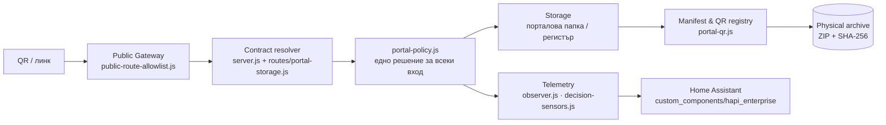

# Runtime Execution Flows

**Документ:** HAPI-ARCH-API-003 · **Приложение към** HAPI-ARCH-API-001 (API Architecture & Runtime Logic Specification)

**Обхват:** как заявката минава от GUI/QR през Gateway до Storage, Manifest и Audit — по РЕАЛНИТЕ функции в кода, не по предложени маршрути. Всяка стъпка назовава файла, който я изпълнява; ако стъпка липсва в кода, това е отбелязано изрично.

> Това приложение е описание на текущата имплементация (0.69.78). Когато кодът се промени, тук се променя СЪЩОТО място — иначе документът започва да лъже.

---

## 1. Обща картина

Трите правила, които държат картината вярна:

1. **Allowlist преди всичко** — заявка, която не съвпада с правило в `public-route-allowlist.js`, не стига до обработчик на публичния слушател.
2. **Едно решение за достъп** — `portal-policy.js` връща `{allowed, via}` за всеки вход (страница, API, файл, архив). Никой маршрут не решава сам.
3. **Папката е истината за файловете** — списъкът идва от диска (`storage-tree.js`), а регистърът добавя правила (режим, основание).

---

## 2. Създаване на портал (admin)

`POST /admin/api/portals` → `server.js` (създаване на портал) → `qrRegistry.ensureFirst(db, p)`.

| # | Стъпка | Кой я прави |
| --- | --- | --- |
| 1 | Проверка на административна идентичност и право `portals` | `adminGate` (RBAC в `rbac.js`) |
| 2 | Проверка за конфликт на `slug` | `getPortal(slug)` → `409` |
| 3 | Валидация на `storage_root` (само `/share` или `/media`, без `..`) | `portalRoot()` |
| 4 | Създаване на вътрешната папка на данните | `fsp.mkdir(filesRoot/<id>)` |
| 5 | Запис на портала в метаданните | `update()` → `sqlite-store.save()` |
| 6 | **Основен QR `QR-001`** | `portal-qr.ensureFirst()` |
| 7 | Артефакти (`api.json`, `openapi.json`, `portal.html`) | `writeApiDir()` |
| 8 | Одитно събитие | `audit('portal.update')` |

Инвариант: портал, записан като успешен, има `QR-001`. Ако стъпка 6 се провали, `update()` не записва — няма „портал без QR“.

## 3. Вход по QR и резолюция на договора (`order`)

`GET /portal.html?order=share/<папка>[/<подпапка>]&qr=QR-00N` → `routes/portal-storage.js : serveOrder()`.

| # | Стъпка | Условие / резултат |
| --- | --- | --- |
| 1 | Allowlist | `GET /portal.html…` е разрешен |
| 2 | Нормализация на `order` | `links.portalFolderRel()` — `..`, празни и невалидни сегменти се изхвърлят |
| 3 | Собственост на папката | `portalRoot(portal.storage_root)` трябва да е ТОЧНО `share/<име>` от `order`; иначе `404` |
| 4 | Право за портала | `portal-policy.decide({action:'read'})` — публичен / бисквитка / подпис / токен |
| 5 | QR идентичност | `qr.registry(db, id).revisions.find(r => r.id === qr)`; непознат → `404` |
| 6 | Прекратен QR | `revision.blockedAt` → `serveBlocked()` (**410**, без съдържание) |
| 7 | Страница | шаблон `portal/portal.html` с `{{BASE}} {{API}} {{FOLDER}} {{QR}} {{FOLDERS}}` |
| 8 | Одит | `audit('portal.order.open', {portalId, order, folder, qr})` |

След това страницата сама иска данните:

- `GET /api/v1/p/<slug>` — манифест на портала;
- `GET /api/v1/p/<slug>/files?limit=…` — регистър;
- `GET /api/v1/p/<slug>/tree?path=/…` — съдържание на папката (при `data-folders="1"`);
- `GET /api/v1/p/<slug>/qr.json` — активен QR, история, архиви;
- `GET /api/v1/p/<slug>/tree/file?path=…` — изтегляне по път (blob).

## 4. Изтегляне на файл от папката

`GET /api/v1/p/<slug>/tree/file?path=/<относителен път>` → `routes/portal-storage.js`.

| # | Проверка | Отказ |
| --- | --- | --- |
| 1 | Право за портала и действие `download` | `404` |
| 2 | `path` нормализиран (`..`, `%2e%2e`, `\`, NUL) | `400` |
| 3 | Файлът в регистъра: `listed:false` (чернова) | `404` |
| 4 | Режим `DISABLED` (недостъпен) | `403` + основанието |
| 5 | Режим `KEY_REQUIRED` (с ключ) | `403` (ключът е на регистрирания адрес) |
| 6 | Скрита/заключена папка по пътя (всички родители) | `404` |
| 7 | Общ корен `/share` или `/media` | `403` |
| 8 | `path.resolve` и `realpath` под реалния корен | `400` / `404` |
| 9 | Само файл (`stat.isFile()`) | `404` |
| 10 | Отдаване | `application/*`, `Content-Disposition: attachment; filename*=UTF-8''…`, `Cache-Control: no-store` |

`Blob` в страницата (`fetch` → `URL.createObjectURL` → `<a download>`) минава през СЪЩИТЕ проверки — той е транспорт, не разрешение.

## 5. Архивиране и следващ QR

`POST /admin/api/portals/<id>/qr/archive` → `routes/portal-qr.js`.

| # | Стъпка | Кой |
| --- | --- | --- |
| 1 | Право `portals` | `adminGate` |
| 2 | Обхождане на папката (без символни връзки) и SHA-256 на всеки файл | `portal-qr.walk()` |
| 3 | Празна папка → `409` | маршрутът |
| 4 | Манифест (`portal_id`, `qr_id`, `revision`, `previous_qr_id`, файлове, `archive_id`) | `portal-qr.manifestFor()` |
| 5 | **Физически ZIP** (`manifest.json` + `files/…`) | `ooxml.zip()` → `buildArchive()` |
| 6 | Запис на файла в `<данни>/archives/<portalId>/<slug>-<qr>-<ar>.zip` | `fsp.writeFile` |
| 7 | Регистрация на архива (`sha256`, `size`, `files`, `createdAt`) | регистърът в `db.portalQr` |
| 8 | Фиксиране на съдържанието към ТОЗИ QR (`manifestHash`, `archiveId`) | регистърът |
| 9 | Следващ QR с `previousQrId` + `previousManifestHash` | регистърът |
| 10 | Одит `qr.archived` | `audit()` |

Ако стъпка 5 или 6 се провали, `update()` хвърля и **не се появява нов QR**, който да сочи към несъществуващ архив.

## 6. Прекратяване (`blok`) и публичната му страна

`POST /admin/api/portals/<id>/qr/block {reason}` → `routes/portal-qr.js`.

- `reason` под 3 знака → `400` (`LOCK_REASON_REQUIRED`).
- Активният QR получава `blockedAt` + `blockReason`; историята и архивите остават.
- След прекратяване архивиране → `409` (няма активен QR).
- Посетител с `?qr=<прекратен>` → `serveBlocked()`: **410**, кой печат, откога, с какво основание, **без** списък на файловете.

## 7. Публичен QR договор и архиви

- `GET /api/v1/p/<slug>/qr.json` — активен QR, ревизии (с `archive: {id, file, sha256, size, files}`) и политика; **без** вътрешни бележки.
- `GET /api/v1/p/<slug>/qr/<qrId>/archive` — ZIP, със същото право `read` като страницата.
- `/api/v1/p/<slug>/qr` (без разширение) — **301** към `qr.svg`; същото правило важи за `/files/<id>/qr`.

## 8. Сензори и Home Assistant

1. `observer.js` записва заявките (нормализирани маршрути — токенът не влиза в името на маршрута).
2. `portal-policy.snapshot()` дава броячите за достъп, `portal-qr.stats(db)` — за QR/архиви/заключени файлове, `decision-sensors.evaluate()` — решението „какво да провериш“.
3. `/admin/api/sensors` връща едно тяло: `security`, `qr`, `guidance`, телеметрия.
4. `custom_components/hapi_enterprise/coordinator.py` превежда блоковете към entity ключове (`_normalize_security`, `_normalize_qr`, `_normalize_guidance`); `sensor.py`/`binary_sensor.py` само ги показват.

**Едно изчисление, три читателя** (панел, API, HA) — интеграцията не брои повторно и не знае прагове.

## 9. Кой решава какво (обобщение)

| Въпрос | Отговор в кода |
| --- | --- |
| Тази заявка allowed ли е за този слушател? | `public-route-allowlist.js` (публичен) / `adminGate` + `rbac.js` (административен) |
| Има ли право този клиент на този портал? | `portal-policy.js` (единствено място) |
| Може ли този файл да се види/свали? | `routes/portal-storage.js` (режим, основание, скрити папки) + `folderMetaOf` |
| Кое съдържание е публикувано под този QR? | `portal-qr.manifestFor()` (манифест + хеш) |
| Какво има в стария печат? | физическият ZIP в `<данни>/archives/` |
| Достигната ли е дълбочината? | `portal-qr.tooDeep()` (3 нива) |
| Какво да провери операторът? | `decision-sensors.js` (`guidance`) |

## 10. Къде НЯМА реализация (честно)

| Липсва | Последица |
| --- | --- |
| Периодична проверка на манифестите (`integrity.failed`) | сензорът „неуспешни проверки на цялостта“ още не съществува; проверката е ръчна (сваляне и сверка на SHA-256) |
| `report_entry_id → content_id` връзка | номерът в комбинирания отчет не е вързан към версия на файл |
| Отделен договор `file` като самостоятелен вход | има per-file QR (`/files/<id>/qr.svg`), но не и страница със собствен списък |
| Изолация на недоверен HTML (`html` договор) | HTML проектът се сервира от `/site/…` с CSP, но без отделен sandbox процес |
| Възстановяване от архива през API | архивът се сваля и проверява ръчно; няма маршрут „върни състоянието“ |
