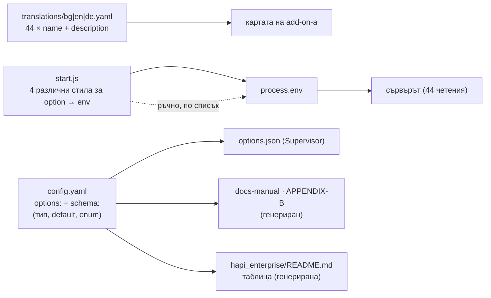

# Задълбочен анализ: осъвършенстване · обединяване · автоматизиране (0.69.227)

> **Клас:** исторически · **Замразен към:** 0.69.244

> **Какво е този документ.** Не списък с пожелания, а измерен инвентар на това къде едно и също
> знание живее на няколко места и какво може да се генерира, вместо да се поддържа на ръка.
> Всяка находка носи число от дървото на **0.69.227** (таг `v0.69.227`, комит `599ea39`), за да
> може да се сравни преди/след. Методът е в §7 — командите са изпълними както са записани.
>
> **Защо сега.** Изданието е публикувано и гейтовете са зелени (матрица **432/432**, `verify-release`
> **22/22**, ГУИ **33/33 · 28/28**). Точно сега е моментът да се гледа „къде знанието е разпръснато“,
> без натиск от дефект — не по време на поправка.

## 1. Карта на дървото (измерено)

| Слой | Файлове | Редове | Най-голям | Забележка |
| --- | --- | --- | --- | --- |
| `hapi_enterprise/*.js` (корен) | **115** | **24 665** | `server.js` **2 706** (пор 2 722) · `qrcode.js` 1 803 (вендор) · `pgp.js` 1 500 | запасът в диспечера е **16 реда** |
| `hapi_enterprise/routes/` | **19** | 3 580 | `portal-storage.js` 481 · `upload-sessions.js` 468 | договор `create(deps) → { handle }` |
| `hapi_enterprise/server_module/` | **2** | 250 | `portal-landing.js` | зареждат се по име, без списък |
| `hapi_enterprise/core_module/` | **3** | 220 | `api-docs.js` | `core.api` е замразен |
| `hapi_enterprise/ui/` | **29** | **17 032** | `files-manager.js` **4 268** · `i18n.js` 3 153 · `settings-panel.js` 1 979 | панелът е най-голямата съвкупност |
| `scripts/` | **45** | 7 201 | `verify-release.cjs` 642 · `release-lib.cjs` 411 | 11 генератора + 34 помощни |
| `tests/` | **434** | **52 328** | — | 433 правила, матрицата пуска 432 |
| `hapi_enterprise/translations/` | 3 | — | — | 44 опции × (name+description) × 3 езика = **264** низа |

Естествени клъстери по префикс (кандидати за папка, не за сливане на файлове):
`portal-*` **9 файла / 1 299 реда**, `public-*` 3 / 604, `report-*` 4 / 1 282, `storage-*` 4 / 324.

## 2. Находка №1 (най-важна): една опция се описва на **пет** места

Опциите са **44**. Днес всяка от тях съществува на тези места:



**Измерено в `start.js`** — четири различни начина за едно и също нещо:

| Стил | Колко | Пример |
| --- | --- | --- |
| директни редове `env.X = optionText('y')` | **12** | `env.BACKUP_DIR = optionText('backup_folder')` ← **името се сменя** |
| таблица `OPTION_ENV` | **13** двойки | `['TSA_ENABLED', 'tsa_enabled']` |
| таблица `PGP_PATH_ENV` | **4** двойки | `['PGP_PATH_PASS', 'pgp_path_pass']` |
| цикъл за флагове | **2** | `pgp_encrypt_paths` → `PGP_ENCRYPT_PATHS` |
| специални случаи (валидация/преименуване) | **4** | `public_domain → PUBLIC_BASE_URL`, `config_dir → HAPI_CONFIG_DIR`, `visitor_geoip_path → GEOIP_DB_PATH`, `token → ADMIN_TOKEN` |

**Защо това е проблем, а не вкус.** Заради преименуванията **не може да се напише статична
проверка** „всяка опция се чете“. Измерено: за **8** от 44 опции env името (главни букви на
ключа) не се среща никъде в кода — при 4 от тях причината е преименуване, при останалите кодът
ги чете по друг път. Тоест днес **нито един гейт не хваща** опция, която потребителят задава, а
нищо не я чете. Същият клас като DEF-85 (липсващ немски), но за опциите.

**Предложение (обединяване + автоматизация): един дескриптор.**
`hapi_enterprise/option-spec.js` (нов, ~120 реда) — по един ред на опция:

```js
{ key: 'backup_folder', env: 'BACKUP_DIR', type: 'folder', default: '',
  empty: 'огледалото е изключено', group: 'storage', secret: false }
```

От него се **генерират** (един генератор, един тест):
1. `schema:` блокът в `config.yaml` (днес се пише на ръка, 44 записа);
2. `translations/{bg,en,de}.yaml` — скелет с `name`/`description` и **гейт**: липсващ превод = грешка;
3. таблицата `OPTION_ENV` в `start.js` — тоест `start.js` остава само със специалните случаи;
4. таблицата в `hapi_enterprise/README.md` и `APPENDIX-B` (днес ги прави `scripts/settings-defaults.cjs`);
5. списъкът с настройки в панела (`settings-panel.js`), където днес редът се поддържа ръчно.

**Нови гейтове (2 теста):**
- нов тест `option-spec` (в `tests/`) — всяка опция от `config.yaml` има ред в дескриптора и обратно; всяка
  има `env`, `type`, `empty`; генерираните файлове са байт по байт от дескриптора.
- нов тест `option-coverage` (в `tests/`) — всяко `env` от дескриптора се **чете** някъде в
  `hapi_enterprise/**` (или е изрично маркирано `forwardOnly`), и обратно: всяко `process.env.X`,
  което идва от опция, е в дескриптора. Това е проверката, която днес липсва.

**Ефект:** −4 таблици за поддръжка, +2 гейта, 0 промени в поведението. Риск: **нисък**
(генераторът първо работи в режим `--check` и само сравнява; тогава пише).

## 3. Находка №2: обхождането на папки съществува в **16** реализации

`function walk(` — **7** в модули (`migration-bridge.js`, `pgp-sign.js`, `portal-folder.js`,
`portal-qr.js`, `server.js`, `storage-migrate.js`, `workdir-migrate.js`) и **9** в `scripts/*.cjs`
(общо **45** `readdirSync` в скриптовете). Всяка копира едно и също: рекурсия, изключване на
`node_modules`/`.git`, понякога `realpath` срещу symlink-изход.

**Защо е проблем.** Точно този клас вече ни е струвал дефекти: `release-lib.cjs` трябваше да
изключва игнорирани пътища (DEF-13/S08), `portal-folder.js` — да не излиза от корена, а
`file-placement.cjs` проверява `require`-ите. Всяко копие може да забрави едно от трите правила и
пак ще е „зелено“, защото тестът гледа друго копие.

**Предложение.** Един нов `hapi_enterprise/walk.js` (~60 реда), който връща `{ path, size, mode }` и
приема политика (`skipDirs`, `skipExt`, `followSymlinks: false`, `rootRealpath`); `scripts/` го
ползва през `require('../hapi_enterprise/walk.js')` (днес `release-lib.cjs` вече е такъв общ
слой, тоест има къде да живее). Скриптовете пазят само политиката си.

**Тест:** нов тест `walk` (в `tests/`) — symlink извън корена се отказва, `node_modules` се пропуска,
дълбочината е стабилна, празна папка се различава от липсваща. **Ефект:** −15 реализации,
+1 тест. **Риск:** среден (пипа се `release-lib`, който строи изданието) → първо минава
`build-release` + `verify-release` в същия комит.

## 4. Находка №3: атомарният запис съществува в **5** модула

`writeAtomic` — `api-registry.js`, `instance-lock.js`, `observer.js`, `packager.js`,
`portal-folder.js`. Всяко прави `tmp` + `rename`, но подробностите (fsync на файл/папка, права
`0600`, режим на `tmp`) се разминават.

**Предложение.** Нов `hapi_enterprise/atomic-write.js` с една политика: `tmp` в **същата** папка
(иначе `rename` през диск), `mode`, `fsync`, „не пипай съществуващ файл, ако съдържанието е
същото“. **Тест:** нов тест `atomic-write` (в `tests/`) — съдържание след прекъсване, права, „същото
съдържание → без запис“). **Ефект:** 5 → 1 реализация; одитът става един ред. **Риск:** среден
(работи се с WORM/одит веригата) → батч със `worm`/`audit-chain` тестовете в същия пуск.

## 5. Находка №4: заглавките и CSP се пишат на ръка на **57** места

Измерено: **57** `res.writeHead(` и **23** CSP литерала (`default-src …`) в `hapi_enterprise/**`.
Днес всеки отговор сам сглобява `Content-Type`, `Cache-Control`, `ETag`, `Referrer-Policy`,
`X-Content-Type-Options`, `Content-Security-Policy` — а `respond.js` дава само `json()`/`fail()`.

**Защо е проблем.** DEF-84 (липсващ `Referrer-Policy` на 4 отговора) и DEF-87/DEF-88 (кеш) са
точно следствие: договорът е текст, който се копира. Един пропуснат ред = дефект, който се
вижда само ако някой тест гледа точно този отговор.

**Предложение.** `scripts/audit-html-headers.cjs` вече има списък `REQUIRED`; следващата стъпка е
**профили**: `html(page)`, `signedJson`, `staticAsset(versioned)`, `download`, `svg`. В
`respond.js` — `send(res, profile, body, extra)`; `writeHead` извън `respond.js` и бъдещия нов `csp.js` става
забранен от тест (нов тест `respond-single-exit`), с изричен allowlist за изключенията.
**Ефект:** 23 литерала → 5 профила; нов отговор наследява целия набор. **Риск:** среден (57
места), затова батчът се дели: първо профилите + една повърхност, после останалите по файл.

## 6. Останали находки, подредени по съотношение стойност/риск

| № | Находка | Измерено | Предложение | Тест | Риск |
| --- | --- | --- | --- | --- | --- |
| F5 | `htmlEsc`/`escapeHtml` в 3 модула, `crypto.createHash` в **32** файла | 3 · 32 | `core_module/html.js` (`escape`, `attr`) и `core_module/hash.js` (`sha256`, `hmac`) — това е точно смисълът на `core.api` | `core-modules.cjs` §нови | нисък |
| F6 | `server.js` **2 706/2 722** — запас 16 реда | 16 | изваждане на панелния маршрут (`UI_FILES` + `uiFile`) в нов `server_module/ui-static.js` по вече съществуващия договор | `server-modules.cjs`, `static-etag.cjs`, `static-cache.cjs` | нисък |
| F7 | `ui/files-manager.js` **4 268** реда; целият панел 17 032 | 4 268 | същият модел като `server_module/`: папка `ui/module/` с автоматично зареждане; първи сегмент — импорт/експорт | `ui-modules.cjs` (нов) + наличните `gui-*` | среден |
| F8 | Порталът е 9 коренни модула + 19 маршрута, адресите се строят на 2 места | DEF-69 отворен | една папка `portal/` (модули + маршрути) и **само** `portal-links.js` строи адрес | `links-contract.cjs`, `portal-creation-contract.cjs` | среден |
| F9 | Тестове: **434** файла / 52 328 реда; **142** копия на `path.join(__dirname, '..')`, **120** `startServer`, 419 `console.log(OK…)` | 142 · 120 | `tests/lib/scenario.cjs` — декларативен план (`{ роля, портал, действие, очакване }`) върху `gui-harness`; нов тест = 10 реда план | сам себе си | среден |
| F10 | `safe-release.cjs` пуска **4** генератора, а в `scripts/` има **11** (+ `settings-defaults`, `function-catalog`, `docs-manual`, `api-reference`, `openapi-admin`, `error-codes`, `audit-events`, `source-inventory`) | 4 vs 11 | регистър `scripts/generators.json`; `safe-release` ги пуска ВСИЧКИ; тест „генератор без ред = грешка“ | `generators-registry.cjs` (нов) | нисък |
| F11 | „Приети“ находки: `bad-code-scan` **222/255**, `logic-audit` 1 приета | 222 | всяка приета находка получава `до: vX` и ратчет, който само пада (моделът на `ui-i18n-ratchet`) | `accepted-ratchet.cjs` (нов) | нисък |
| F12 | `start.js` — 3 таблици + 12 ad-hoc реда | 4 стила | следствие от F1 (дескрипторът ражда таблицата) | `option-spec.cjs` | нисък |
| F13 | Един договор се пази от няколко теста: CSP в `html-headers` **и** `panel-framing`; адреси в `links-contract`, `portal-creation-contract`, `gui-portal-create-contract` | 2 · 3 | общ `tests/lib/contracts.cjs` с функции `expectCsp(res)`, `expectAddresses(obj)` — тестовете викат проверката, не я преписват | `contracts.cjs` §собствен | нисък |

## 7. Как е измерено (възпроизводимо)

```powershell
# размери по слоеве
Get-ChildItem hapi_enterprise -Filter *.js | ForEach-Object { (Get-Content $_ | Measure-Object -Line).Lines }
# дублирани имена на функции (≥3 файла)
# → regex '(?m)^\s*(?:async\s+)?function\s+([A-Za-z_$][\w$]*)\s*\(' по hapi_enterprise/**/*.js
# разпръснати похвати
# → 'writeAtomic' (5), 'function walk' (7+9), 'crypto.createHash' (32), 'default-src' (23), 'writeHead(' (57)
# опции
# → блокът options: в config.yaml (44) · translations/bg.yaml (44 ключа) · start.js (4 стила)
# тестове
# → tests/*.cjs (434) · "path.join(__dirname, '..')" (142) · 'startServer(' (120)
```

## 8. Ред на изпълнение (батчове, всеки със свой тест и свой комит)

| Батч | Какво влиза | Защо първо | Очакван ефект |
| --- | --- | --- | --- |
| **B1** | F10 (регистър на генераторите) + F1 част 1 (`option-spec.js` в режим `--check`) | чисто добавено, нищо не се мести; веднага хваща разминаване | 1 гейт, 0 риска |
| **B2** | F1 част 2 (генериране на schema/преводи/таблица) + F12 | знанието за опциите става едно | −4 таблици, +2 гейта |
| **B3** | F2 (нов `walk.js`) + F3 (нов `atomic-write.js`) | двете най-разпръснати примитиви; тестовете им са независими от UI | 16 → 1 · 5 → 1 |
| **B4** | F5 (`core_module/html.js`, `hash.js`) | глобалният слой вече съществува точно за това | 3 → 1 · 32 → 1 |
| **B5** | F6 (`server_module/ui-static.js`) | връща запаса в диспечера (16 → ~40 реда) | бюджетът спира да е пречка |
| **B6** | F4 (профили на заглавките, по един файл на комит) | най-много места (57), затова последно и на части | 23 литерала → 5 профила |
| **B7** | F7 (`ui/module/`) + F9 (`tests/lib/scenario.cjs`) | най-голямата печалба за поддръжка, най-голям риск | 4 268 → ~4×800 реда |
| **B8** | F8 (`portal/` папка, DEF-69 затваряне) + F13 | изисква B2/B3/B4 да са минали | адресите на едно място |

**Правило за всеки батч:** промяна в код → тест, който би паднал без нея; ред в
`KNOWN_DEFECTS.md`, ако се затваря дефект, + котва в `regression-guards.cjs`; генератори →
`build-release` → матрицата ДВА пъти (първият пуск записва отпечатъка) → `release-status`.

## 9. Какво съзнателно НЕ се пипа

- **`qrcode.js`** (1 803 реда) — вендор; `evidence-portal-qr.cjs` пази копието еднакво.
- **`pgp.js`** (1 500 реда) — крипто; поправка там иска външен преглед, не рефакторинг.
- **`pdf-writer.js`, `ooxml.js`** — формати с твърд договор; обединяването им няма печалба.
- **Моделът на матрицата** (2 пуска след промяна) — това е цена за сигурността на гейта, не
  разхищение.

## 10. Очакван резултат след батчовете

| Показател | Днес (0.69.227) | След B1–B5 | След B7 |
| --- | --- | --- | --- |
| Места, където живее една опция | **5** | **1** (дескриптор) + генерирани | 1 |
| Реализации на обхождане на папки | **16** | **1** | 1 |
| Реализации на атомарен запис | **5** | **1** | 1 |
| CSP литерала | **23** | 23 → 5 (B6) | 5 |
| `server.js` редове (пор 2 722) | 2 706 | ~2 670 | ~2 670 |
| Най-голям UI модул | **4 268** | 4 268 | ~800 |
| Гейтове за „опция без читател“ | **0** | **1** | 1 |
| Генератори, пуснати от `safe-release` | 4 от 11 | **11 от 11** | 11 |
